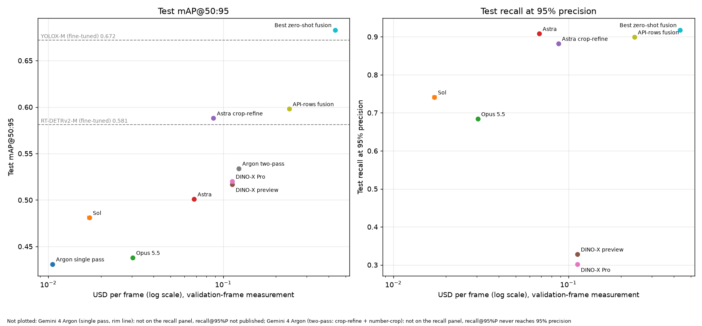

<!-- GENERATED by scripts/cost_report.py from benchmarks/basketball/results/cost/cost_per_frame.json. Do not edit by hand: edit the inputs and rerun the script. -->

# What each zero-shot pipeline costs per frame

Each pipeline was rerun on 20 validation frames, 2 times, with every response cache and checkpoint bypassed and at the `--workers` it was published with. The test split was not touched: USD and seconds are measured on validation frames (1920x1080 on every split, so image-token counts transfer), and the accuracy columns are copied from the committed reports, not recomputed. Cost comes from per-call usage logs (`benchmarks/basketball/results/cost/usage/`) priced with a committed table (`conf/cost_prices.yaml`); nothing is hand arithmetic.

Read the numbers with these limits in mind:

- With 2 runs the run-to-run SD is a rough indication, not a confidence interval.
- Latency depends on provider load and the time of day; it is one afternoon's measurement, not a service-level figure.
- The Gemini 4 Argon price doubles on 2026-12-01 (input $2 to $4, output $10 to $20 per 1M tokens). Both prices are shown.
- DINO-X is billed per call, in CNY, from a console balance. Its price is an approximate per-call figure converted to USD at a dated exchange rate (see the note in `conf/cost_prices.yaml`). A model with no price is shown unpriced, and any fused line containing it carries a lower bound that leaves it out.
- Single-run accuracy gaps of about 2 points between the API rows are within the published run-to-run noise (VLM_VS_FINETUNED.md, "Parity with the Ultralytics Platform benchmark"). Do not read a ranking into small differences in the accuracy columns.

## Headline

| Pipeline | test mAP@50:95 | recall@95%P | calls/frame mean (max) | USD/frame now | USD per 1,000 frames now | USD/frame from 2026-12-01 | USD per 1,000 from 2026-12-01 | s/frame serial | s/frame at published workers (N) |
| --- | --- | --- | --- | --- | --- | --- | --- | --- | --- |
| Gemini 4 Argon (single pass, rim line) | 0.431 | n/a (not published) | 1.0 (1) | $0.0106 ± $0.0001 | $10.57 | $0.0211 ± $0.0002 | $21.15 | 11.0 ± 1.6 | 11.0 ± 1.6 (1) |
| GPT-6.1 Sol (single pass) | 0.481 | 0.741 | 1.0 (1) | $0.0172 ± $0.0004 | $17.16 | $0.0172 ± $0.0004 | $17.16 | 21.2 ± 0.8 | 21.2 ± 0.8 (1) |
| Claude Opus 5.5 (single pass) | 0.438 | 0.684 | 1.0 (1) | $0.0303 ± $0.0001 | $30.34 | $0.0303 ± $0.0001 | $30.34 | 8.2 ± 0.1 | 8.2 ± 0.1 (1) |
| GPT-6 Astra (single pass) | 0.501 | 0.908 | 1.0 (1) | $0.0681 ± $0.0002 | $68.08 | $0.0681 ± $0.0002 | $68.08 | 10.1 ± 0.2 | 10.1 ± 0.2 (1) |
| Astra crop-refine (ball + rim) | 0.588 | 0.882 | 2.8 (3) | $0.0878 ± $0.0010 | $87.81 | $0.0878 ± $0.0010 | $87.81 | 15.5 ± 1.3 | 15.5 ± 1.3 (1) |
| DINO-X preview + rim trim (2x2 tiles + full frame) | 0.517 | 0.328 | 5.0 (5) | $0.1125 ± $0.0000 | $112.50 | $0.1125 ± $0.0000 | $112.50 | 31.6 ± 1.0 | 4.2 ± 0.1 (8) |
| DINO-X Pro + rim trim (2x2 tiles + full frame) | 0.520 | 0.302 | 5.0 (5) | $0.1125 ± $0.0000 | $112.50 | $0.1125 ± $0.0000 | $112.50 | 21.0 ± 2.9 | 3.2 ± 0.8 (8) |
| Gemini 4 Argon (two-pass: crop-refine + number-crop) | 0.534 | n/a (never reaches 95% precision) | 12.6 (13) | $0.1227 ± $0.0019 | $122.68 | $0.2454 ± $0.0037 | $245.36 | 149.7 ± 0.3 | 53.0 ± 0.2 (3) |
| API-rows fusion (Astra + Sol + Opus + Gemini two-pass, WBF) | 0.598 | 0.899 | 15.6 (16)* | $0.2383 ± $0.0026 | $238.27 | $0.3609 ± $0.0044 | $360.95 | 189.2 ± 0.6 | 92.5 ± 1.1† |
| Best zero-shot line (Astra crop-refine + DINO-X Pro + DINO-X preview + Gemini two-pass, WBF) | 0.683 | 0.918 | 25.4 (26)* | $0.4355 ± $0.0009 | $435.49 | $0.5582 ± $0.0027 | $558.17 | 217.8 ± 2.9 | 75.9 ± 0.6† |

`calls/frame` counts every billed request for a frame, including second-pass crop calls and tile calls; the figure in brackets is the largest count for any single frame. USD is mean ± SD over the runs. `s/frame serial` is the mean of each frame's own wall time; `s/frame at published workers` is run wall time divided by frames, which is what the published concurrency delivers.

\* A fused line has no calls of its own: it is the sum of its members' calls (WBF itself is free). Its call mean is the sum of the members' means; its call max is the sum of the members' maxima, an upper bound rather than a joint statistic.

† A fused line's latency is the sum of its members' (they run one after another). The slowest member alone is the lower bound if they ran in parallel:

- API-rows fusion (Astra + Sol + Opus + Gemini two-pass, WBF): serial sum 189.2 s/frame, parallel lower bound 149.7 s/frame (members: astra, sol, claude_opus, gemini_argon_two_pass).
- Best zero-shot line (Astra crop-refine + DINO-X Pro + DINO-X preview + Gemini two-pass, WBF): serial sum 217.8 s/frame, parallel lower bound 149.7 s/frame (members: astra_crop_refine, dinox_pro_rimtrim, dinox_preview_rimtrim, gemini_argon_two_pass).

## Calls and tokens

| Pipeline | calls pass 1 | calls pass 2 | input tok/frame (text / image / cached) | billable output tok/frame | of which reasoning | retries | errors |
| --- | --- | --- | --- | --- | --- | --- | --- |
| Gemini 4 Argon (single pass, rim line) | 1.0 | 0.0 | 1,707 (607 / 1,100 / n/a) | 716 | n/a | 0 | 0 |
| GPT-6.1 Sol (single pass) | 1.0 | 0.0 | 3,086 (n/a / n/a / 1,088) | 1,099 | 402 | 0 | 0 |
| Claude Opus 5.5 (single pass) | 1.0 | 0.0 | 2,950 (n/a / n/a / 0) | 927 | 0 | 0 | 0 |
| GPT-6 Astra (single pass) | 1.0 | 0.0 | 3,086 (n/a / n/a / 128) | 744 | 60 | 0 | 0 |
| Astra crop-refine (ball + rim) | 1.0 | 1.8 | 4,134 (n/a / n/a / 1,024) | 929 | 153 | 0 | 0 |
| DINO-X preview + rim trim (2x2 tiles + full frame) | 5.0 | 0.0 | n/a (n/a / n/a / n/a) | n/a | n/a | 0 | 0 |
| DINO-X Pro + rim trim (2x2 tiles + full frame) | 5.0 | 0.0 | n/a (n/a / n/a / n/a) | n/a | n/a | 0 | 0 |
| Gemini 4 Argon (two-pass: crop-refine + number-crop) | 1.0 | 11.6 | 20,244 (6,557 / 13,687 / n/a) | 8,219 | 6,903 | 0 | 0 |
| API-rows fusion (Astra + Sol + Opus + Gemini two-pass, WBF) | 4.0 | 11.6 | 29,366 (6,557 / 13,687 / 1,216) | 10,990 | 7,365 | 0 | 0 |
| Best zero-shot line (Astra crop-refine + DINO-X Pro + DINO-X preview + Gemini two-pass, WBF) | 12.0 | 13.4 | 24,378 (6,557 / 13,687 / 1,024) | 9,149 | 7,056 | 0 | 0 |

Cached input tokens were reported for at least one pipeline and are billed at the full input rate here; the cost model has no cache discount.

## Spend

The whole study cost **$24.13** at the prices in force on each call's date, counting projection runs and any aborted run.



## Prices

| Model id | Provider | Period | Price | Source |
| --- | --- | --- | --- | --- |
| DINO-X-1.0 | deepdataspace | ... to ... | $0.0225 per call | https://cloud.deepdataspace.com/dashboard/usage |
| DINO-X-PREVIEW-1.0 | deepdataspace | ... to ... | $0.0225 per call | https://cloud.deepdataspace.com/dashboard/usage |
| T-Rex-2.0 | deepdataspace | ... to ... | per-call price not yet supplied | https://cloud.deepdataspace.com/dashboard/usage |
| claude-opus-5-5 | anthropic | ... to ... | $4 in / $20 out per 1M tokens | https://claude.com/pricing |
| gemini-4-argon | google | ... to 2026-11-30 | $2 in / $10 out per 1M tokens | https://ai.google.dev/gemini-api/docs/pricing |
| gemini-4-argon | google | 2026-12-01 to ... | $4 in / $20 out per 1M tokens | https://ai.google.dev/gemini-api/docs/pricing |
| gpt-6-astra | openai | ... to ... | $10 in / $50 out per 1M tokens | https://developers.openai.com/api/docs/pricing |
| gpt-6.1-sol | openai | ... to ... | $2 in / $10 out per 1M tokens | https://developers.openai.com/api/docs/pricing |

Reasoning and thinking tokens are billed at the output rate by all three token-priced providers; whether a response's `output_tokens` already includes them is recorded per call, so reasoning is neither double-counted nor missed.

## Where each accuracy number comes from

| Pipeline | Metric | Value | Source |
| --- | --- | --- | --- |
| astra | test mAP@50:95 | 0.501 | `benchmarks/basketball/reports/VLM_VS_FINETUNED.md` (The zero-shot ceiling (vlm_summary table)) |
| astra | recall@95%P | 0.908 | `benchmarks/basketball/results/vlm/fusion/api_fusion_gemini_test.json` (On the test split, scored once (Superseded note)) |
| astra_crop_refine | test mAP@50:95 | 0.588 | `benchmarks/basketball/reports/VLM_VS_FINETUNED.md` (The zero-shot ceiling (fused-line table, row "Astra crop-refine alone")) |
| astra_crop_refine | recall@95%P | 0.882 | `benchmarks/basketball/reports/VLM_VS_FINETUNED.md` (The zero-shot ceiling (fused-line table, row "Astra crop-refine alone")) |
| sol | test mAP@50:95 | 0.481 | `benchmarks/basketball/reports/VLM_VS_FINETUNED.md` (The zero-shot ceiling (vlm_summary table)) |
| sol | recall@95%P | 0.741 | `benchmarks/basketball/results/vlm/repeats/recall_at_p95_test.json` (run 1 = the published row; three-run mean 0.820 +/- 0.078 (scripts/recall_at_p95_api_rows.py)) |
| claude_opus | test mAP@50:95 | 0.438 | `benchmarks/basketball/reports/VLM_VS_FINETUNED.md` (The zero-shot ceiling (vlm_summary table)) |
| claude_opus | recall@95%P | 0.684 | `benchmarks/basketball/results/vlm/repeats/recall_at_p95_test.json` (run 1 = the published row; three-run mean 0.662 +/- 0.037 (scripts/recall_at_p95_api_rows.py)) |
| gemini_argon_single | test mAP@50:95 | 0.431 | `benchmarks/basketball/reports/VLM_VS_FINETUNED.md` (The zero-shot ceiling ("Test, run once"; also docs/plans/gemini-argon-2026-10.md "Test (run once)")) |
| gemini_argon_single | recall@95%P | n/a (not published) | no report or results file carries recall at 95% precision for this row |
| gemini_argon_two_pass | test mAP@50:95 | 0.534 | `benchmarks/basketball/reports/VLM_VS_FINETUNED.md` (The zero-shot ceiling (vlm_summary table)) |
| gemini_argon_two_pass | recall@95%P | n/a (never reaches 95% precision) | `benchmarks/basketball/reports/VLM_VS_FINETUNED.md` (On the test split, scored once (vlm_fusion_test table, gemini row)) |
| dinox_pro_rimtrim | test mAP@50:95 | 0.520 | `benchmarks/basketball/reports/VLM_VS_FINETUNED.md` (The zero-shot ceiling (rim box trim paragraph)) |
| dinox_pro_rimtrim | recall@95%P | 0.302 | `benchmarks/basketball/results/vlm/fusion/dinox_astra_pairs.json` (no report prints it) |
| dinox_preview_rimtrim | test mAP@50:95 | 0.517 | `benchmarks/basketball/reports/VLM_VS_FINETUNED.md` (The zero-shot ceiling (rim box trim paragraph)) |
| dinox_preview_rimtrim | recall@95%P | 0.328 | `benchmarks/basketball/results/vlm/fusion/dinox_astra_pairs.json` (no report prints it) |
| fusion4 | test mAP@50:95 | 0.683 | `benchmarks/basketball/reports/VLM_VS_FINETUNED.md` (The zero-shot ceiling (fused-line table)) |
| fusion4 | recall@95%P | 0.918 | `benchmarks/basketball/reports/VLM_VS_FINETUNED.md` (The zero-shot ceiling (fused-line table)) |
| api_fusion4 | test mAP@50:95 | 0.598 | `benchmarks/basketball/reports/VLM_VS_FINETUNED.md` (Improving the API rows: fusion and rim crop-refine (Gemini table)) |
| api_fusion4 | recall@95%P | 0.899 | `benchmarks/basketball/results/vlm/fusion/api_fusion_gemini_test.json` (docs/plans/fusion-refresh-2026-10.md "F2. API models") |
| YOLOX-M (fine-tuned) | test mAP@50:95 | 0.672 | `benchmarks/basketball/reports/FINAL_COMPARISON_640.md` (main table) |
| RT-DETRv2-M (fine-tuned) | test mAP@50:95 | 0.581 | `benchmarks/basketball/reports/FINAL_COMPARISON_640.md` (main table) |

## Runs

| Pipeline | Run | Frames | Workers | Run wall (s) | Status | git | Env |
| --- | --- | --- | --- | --- | --- | --- | --- |
| astra | 1 | 20 | 1 | 199.8 | complete | b66a8d1d1f | vlm-astra |
| astra | 2 | 20 | 1 | 205.7 | complete | b66a8d1d1f | vlm-astra |
| astra_crop_refine | 1 | 20 | 1 | 292.3 | complete | b66a8d1d1f | vlm-astra |
| astra_crop_refine | 2 | 20 | 1 | 327.8 | complete | b66a8d1d1f | vlm-astra |
| claude_opus | 1 | 20 | 1 | 166.1 | complete | b66a8d1d1f | vlm-claude |
| claude_opus | 2 | 20 | 1 | 162.6 | complete | b66a8d1d1f | vlm-claude |
| dinox_preview_rimtrim | 1 | 20 | 8 | 84.7 | complete | b66a8d1d1f | default |
| dinox_preview_rimtrim | 2 | 20 | 8 | 82.0 | complete | b66a8d1d1f | default |
| dinox_pro_rimtrim | 1 | 20 | 8 | 75.4 | complete | b66a8d1d1f | default |
| dinox_pro_rimtrim | 2 | 20 | 8 | 54.1 | complete | b66a8d1d1f | default |
| gemini_argon_single | 1 | 20 | 1 | 242.5 | complete | b66a8d1d1f | vlm |
| gemini_argon_single | 2 | 20 | 1 | 197.2 | complete | b66a8d1d1f | vlm |
| gemini_argon_two_pass | 1 | 20 | 3 | 1056.9 | complete | b66a8d1d1f | vlm |
| gemini_argon_two_pass | 2 | 20 | 3 | 1062.7 | complete | b66a8d1d1f | vlm |
| sol | 1 | 20 | 1 | 412.9 | complete | b66a8d1d1f | vlm-astra |
| sol | 2 | 20 | 1 | 434.5 | complete | b66a8d1d1f | vlm-astra |

| Pipeline | Published --workers | Evidence |
| --- | --- | --- |
| astra | 1 | vlm_zeroshot.yaml row `astra`; run_vlm_benchmark.py had no --workers at 0ed62dd, and at HEAD _CONCURRENT_INFERENCERS = {"gemini"}, so astra rows are scored serially. |
| astra_crop_refine | 1 | scripts/run_astra_crop_refine.py `--model astra` defaults (_BASE_PROMPT, effort low, pad 1.5, refine ball,rim); the script has no --workers and score_split defaults to workers=1 (909bcb1 and HEAD). |
| sol | 1 | vlm_zeroshot.yaml row `sol` (effort default); run_vlm_benchmark.py had no --workers at 909bcb1. |
| claude_opus | 1 | vlm_zeroshot.yaml row `claude_opus` (effort default); run_vlm_benchmark.py had no --workers at 909bcb1. |
| gemini_argon_single | 1 | INFERRED, not recorded. The Oct-14 test row is byte-identical to the vlm_ablation.yaml arm `rim_def_argon` (docs/plans/gemini-argon-2026-10.md "Test (run once)"), and run_vlm_benchmark.py had no --workers until 9c46399 (2026-10-21), so that test run was serial. The val arms used `ablate_vlm.py --workers N` with N unrecorded (capped at 3). |
| gemini_argon_two_pass | 3 | docs/plans/gemini-argon-2026-10.md "Round 3 test": "With `--workers 3`, the repeat took 95 minutes". |
| dinox_pro_rimtrim | 8 | ASSUMED default. scripts/explore_dinox.py `--workers` defaults to 8 at ff353c8 and the docs record no override. Arm r6_trim0.35_headline: DINO-X-1.0, 2x2 tiles + full frame, merge NMS 0.5, rim trim 0.35. |
| dinox_preview_rimtrim | 8 | ASSUMED default. scripts/explore_dinox.py `--workers` defaults to 8 at ff353c8 and the docs record no override. Arm r9_trim0.3_preview: DINO-X-PREVIEW-1.0, same tiling, rim trim 0.3. |

## Billing cross-check

The OpenAI and Anthropic admin billing checks were skipped by user decision on 2026-10-27, so this report has no billing-comparison column. The Google Cloud export and the DeepDataSpace console steps are written up for the user to perform: [Google Cloud Billing export](../../../docs/cost/gcp-billing-export.md) and [DINO-X console checklist](../../../docs/cost/dinox-console-checklist.md).

## Reproducing this page

```
pixi run python scripts/cost_report.py
pixi run python scripts/cost_report.py --check
```
