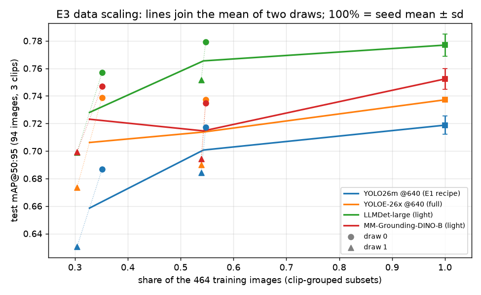

# Fine-Tuning Foundation Models on 464 Images

[VLM_VS_FINETUNED.md](VLM_VS_FINETUNED.md) scored open-weights foundation models
zero-shot. This report fine-tunes them, and a few more, on the same 464 training images,
then retrains the two best conventional detectors from
[FINAL_COMPARISON_640.md](FINAL_COMPARISON_640.md) under the same protocol and at the
same input resolution. Every number below was selected on `valid`, predicted on `test`
once, and scored with the scorer every published row uses. Every table is generated
from committed results files (see [Reproducing](#reproducing-these-numbers)); prose
numbers are copied from those tables.

## 1. The finding: at matched resolution, the conventional detectors tie the best foundation models

The overnight round put the best foundation models 5-7 points above YOLO26m. Most of
that lead was input resolution, and the test now runs in **both directions**. The
published detectors ran at 640 px; LLMDet and MM-Grounding-DINO run at short side 800,
and YOLOE / YOLO-World at 1280. Retrained at 1280 with the same equal-effort recipe, **DEIM-M scores 0.782 ± 0.011 (3 seeds) at
18.2 ms TensorRT fp16 on a T4, and YOLO26m 0.771 ± 0.002 at 20.2 ms**. The best
foundation models are in the same place: LLMDet-large 0.777 ± 0.008 (light arm, 3 seeds)
and 0.785 (full), at 335 ms; YOLOE-26x and YOLO-World-v2-x at 1280, 0.775 and 0.776
(39 and 51 ms). Every matched-resolution pair below is a clustered-CI tie: the largest
gaps are DEIM-M @1280 ahead of MM-Grounding-DINO by 2.9 points (2 of 3 clips) and ahead
of YOLO-World by 0.5 points on all 3 clips, an interval that touches zero. Against the
640 px baselines, LLMDet at its native input is 6-8 points ahead on every clip.

**The other direction (E5).** Retrained and evaluated at the baselines' 640 input (long
side 640, so a 1080p frame is 640x360), the grounding models lose that lead. LLMDet-large
drops to 0.695 ± 0.002 (light, 3 seeds; full 0.696), a clustered tie with DEIM-M @640
(-0.4 points) and 2.3 points below YOLO26m @640 on the point estimate, also a tie (1 of 3
clips; CI -0.072 to +0.034). MM-Grounding-DINO drops to 0.574 ± 0.010, below both 640
baselines on every clip (-14.4 points vs YOLO26m, -12.5 vs DEIM-M). At 640 the TensorRT
engines are about 3x faster (LLMDet 106.6 ms, MM-Grounding-DINO 50.9 ms) and still 7-18x
the 640 detectors. E5 trained at one fixed scale, because the 640 cap collapsed the
round-1 multi-scale jitter. **E6 restores that jitter**, rescaled to the 640 scale, and
adds under 1 point: LLMDet-large 0.702 ± 0.004 (+0.7 points over E5, a clustered tie) and
MM-Grounding-DINO 0.583 ± 0.012 (+0.9, a tie). So the 640 drop is resolution, not lost
augmentation. With matched augmentation LLMDet still ties both 640 baselines, and
MM-Grounding-DINO is still below both on every clip (see [section 6](#6-resolution-parity-640-vs-1280-e2)).

<!-- TABLE:ft_headline START -->
| Model / configuration | Input | Seeds | Val | Test (mean ± sd over seeds) | Test, clustered 95% CI | ball AP50 | number AP50 | T4 TensorRT fp16 GPU (ms) |
| --- | --- | --- | --- | --- | --- | --- | --- | --- |
| DEIM-M @1280, E1 recipe | 1280 | 3 | 0.774 | 0.782 ± 0.011 | [0.762, 0.805] | 0.930 | 0.960 | 18.2 |
| YOLO26m @1280, E1 recipe | 1280 | 3 | 0.759 | 0.771 ± 0.002 | [0.741, 0.805] | 0.918 | 0.948 | 20.2 |
| LLMDet-large, light (peft) | short side 800, long cap 1333 | 3 | 0.735 | 0.777 ± 0.008 | [0.740, 0.817] | 0.922 | 0.961 | 334.8 |
| LLMDet-large, full | short side 800, long cap 1333 | 1 | 0.739 | 0.785 | [0.766, 0.813] | 0.919 | 0.965 | 334.8 |
| YOLOE-26x @1280, full (`yoloe_full`) | 1280 | 1 | 0.774 | 0.775 | [0.740, 0.802] | 0.879 | 0.972 | 39.0 |
| YOLO-World-v2-x @1280, full (`yoloworld_full`) | 1280 | 1 | 0.762 | 0.776 | [0.746, 0.804] | 0.886 | 0.984 | 50.7 |
| MM-Grounding-DINO-B, light (peft) | short side 800 (1422x800) | 3 | 0.716 | 0.752 ± 0.008 | [0.712, 0.801] | 0.921 | 0.968 | 143-161 |
| SAM 3, full | 1008x1008 | 1 | 0.709 | 0.737 | [0.684, 0.776] | 0.924 | 0.916 | 432.1 |
| DEIM-M @640, E1 recipe | 640 | 3 | 0.707 | 0.700 ± 0.005 | [0.653, 0.733] | 0.853 | 0.912 | 6.78 |
| YOLO26m @640, E1 recipe | 640 | 3 | 0.699 | 0.719 ± 0.007 | [0.686, 0.745] | 0.837 | 0.934 | 5.85 |
| YOLOE-26x @640, full (`yoloe_full_640`) | 640 | 1 | 0.708 | 0.737 | [0.712, 0.763] | 0.862 | 0.949 | 11.3 |
| LLMDet-large @640, light (peft) | 640x360 (long side 640) | 3 | 0.681 | 0.695 ± 0.002 | [0.614, 0.772] | 0.905 | 0.929 | 106.6 |
| LLMDet-large, full @640 (long side 640) | 640x360 (long side 640) | 1 | 0.684 | 0.696 | [0.608, 0.776] | 0.868 | 0.929 | 106.6 |
| MM-Grounding-DINO-B @640, light (peft) | 640x360 (long side 640) | 3 | 0.576 | 0.574 ± 0.010 | [0.508, 0.637] | 0.792 | 0.846 | 50.9 |
<!-- TABLE:ft_headline END -->

<!-- TABLE:ft_headline_pairs START -->
| A | B | Test A - B [clustered 95% CI] | Clips A ahead | Reading |
| --- | --- | --- | --- | --- |
| DEIM-M @1280, E1 recipe | LLMDet-large, light (peft) | +0.005 [-0.019, +0.024] | 2 of 3 | tie (CI includes 0) |
| DEIM-M @1280, E1 recipe | LLMDet-large, full | -0.004 [-0.015, +0.022] | 1 of 3 | tie (CI includes 0) |
| YOLO26m @1280, E1 recipe | LLMDet-large, light (peft) | -0.006 [-0.047, +0.024] | 2 of 3 | tie (CI includes 0) |
| YOLO26m @1280, E1 recipe | YOLOE-26x @1280, full (`yoloe_full`) | -0.004 [-0.031, +0.007] | 2 of 3 | tie (CI includes 0) |
| DEIM-M @1280, E1 recipe | YOLO-World-v2-x @1280, full (`yoloworld_full`) | +0.005 [0.000, +0.017] | 3 of 3 | tie (CI includes 0) |
| DEIM-M @1280, E1 recipe | MM-Grounding-DINO-B, light (peft) | +0.029 [-0.003, +0.053] | 2 of 3 | tie (CI includes 0) |
| LLMDet-large, light (peft) | YOLO26m @640, E1 recipe | +0.058 [+0.036, +0.079] | 3 of 3 | A above B on every resample |
| LLMDet-large, light (peft) | DEIM-M @640, E1 recipe | +0.077 [+0.056, +0.088] | 3 of 3 | A above B on every resample |
<!-- TABLE:ft_headline_pairs END -->

Where the foundation models still differ is **data efficiency**: on the clip-grouped
25% subsets they lose less than YOLO26m does (see [E3](#7-data-scaling-e3)). But which
clips a subset contains moves the score about as much as how many images it has, and
those runs are single-seed, so this is a tendency, not a measured gap.

### Read this first: the test set is three clips

The 94 test images are frames of **3 video clips**. Frames from one clip are near
duplicates, so the effective sample size is closer to 3 than to 94. Every interval in
this report is a **clip-clustered bootstrap**: it resamples whole clips and enumerates
all 10 distinct resamples exactly. A row is "above" another only if it wins on every
clip by a margin no resample reverses, and the best one-sided sign test three clips can
give is **p = 1/8 = 0.125**. Nothing here is significant at 5%. "Tie" means the test set
cannot tell two rows apart, not that they are equal. The image-level bootstrap, which
treats frames as independent, is kept in the appendix for contrast only.

<!-- TABLE:ft_caveat START -->
**94 test images = 3 video clips (30 / 33 / 31 frames).** The clip-clustered bootstrap enumerates all 10 distinct clip resamples.

- Of 26 main arms (peft and full, seed 0): **7 tie YOLO26m**, 7 above, 12 below (clustered 95% CI). The image-level bootstrap would call 24 of 26 significant.
- Of 68 foundation-model rows (seeds, variants and round 2 included): **23 tie YOLO26m**, 18 above, 27 below (clustered 95% CI). The image-level bootstrap would call 33 of 35 significant.

**What "above" means with 3 clips.** 7 of the 7 main-arm rows called above YOLO26m won all 3 clips. With 3 clusters the percentile interval excludes zero when a row wins every clip by a margin no resample can reverse, and a one-sided sign test on 3 of 3 clips gives p = 1/8 = 0.125. So "above" reads as "ahead on every clip we have", not as significance at 5%; only more test clips can tighten it.
<!-- TABLE:ft_caveat END -->

## 2. Setup and protocol

- **Data.** Basketball, CC BY 4.0: 464 train / 96 val / 94 test images, from 15 / 3 / 3
  clips. Every run trains and is scored on the **merged5** taxonomy (player, ball,
  referee, rim, number); [TAXONOMY_ABLATION.md](TAXONOMY_ABLATION.md) found that training
  on merged5 instead of the raw 10 classes makes no difference for these detectors.
- **Selection on val only.** Checkpoints, learning rates and recipe variants are chosen
  on `valid`. `test` is predicted **once** per run, from the val-selected checkpoint, and
  never used to choose anything. The two exceptions are disclosed where they occur: the
  DEIM-M sweep configurations were each predicted on test after training (selection
  still used val), and three generative-VLM runs were predicted on test after an audit
  found a recipe problem and the user approved the fix ([section 10](#10-generative-vlms-and-the-audit-corrections)).
- **Scorer.** The prediction dumps of every row are committed under `results/finetune/`
  and rescored here with `score_vlm_metrics`, the function every published row uses. The
  fine-tuning repo's own metrics files are only cross-checked (all agree to 1e-4).
- **Seeds.** Headline arms have 3 seeds; everything else is seed 0. The seed spread is
  training noise on a fixed test set; the clustered interval is test-set noise and is
  the larger term.
- **Compute.** vast.ai, one box per run, on mixed GPUs (RTX 4090 to A100), so training
  hours are not comparable across rows. Training code, plan docs and per-run
  `meta.json` are in the `foundation-finetune` repo.

## 3. Light, mid and full fine-tuning

Each foundation model was fine-tuned at up to three levels:

- **Light** (`peft`): the pretrained image backbone (and text encoder) stays frozen.
  Open-vocab detectors train their fusion / decoder / heads, or only the heads; the
  generative VLMs train LoRA adapters on the language model.
- **Mid** (round 2, E4): light plus the last stage of the image backbone at a reduced
  learning rate. Detectors only.
- **Full**, of three types: **(a) uniform**, every weight at one learning rate;
  **(b) discriminative lr**, every weight trains but the pretrained parts at a reduced
  lr or with layer-wise decay; **(c) partial**, a part of the foundation (usually the
  vision tower of a VLM) stays frozen even in the full arm.

<!-- TABLE:ft_taxonomy START -->
| Model | Light trains | Light | Mid adds | Mid | Full type | Full | Full-type detail |
| --- | --- | --- | --- | --- | --- | --- | --- |
| LLMDet-large | fusion encoder, decoder, heads (Swin-L and BERT frozen) | 11.4% (39.0M / 343.1M) | light + Swin-L stage 4 at lr x0.1 | 29.3% (100.4M / 343.1M) | (b) discriminative lr: all weights, pretrained parts at reduced lr | 100.0% (343.1M / 343.1M) | Swin-L + BERT at 0.1x |
| MM-Grounding-DINO-B | feature enhancer, decoder, heads (Swin-B and BERT frozen) | 16.0% (37.2M / 233.0M) | light + Swin-B stage 4 at lr x0.1 | 26.8% (62.4M / 233.0M) | (b) discriminative lr: all weights, pretrained parts at reduced lr | 100.0% (233.0M / 233.0M) | Swin-B + BERT at 0.1x (run A, selected) |
| SAM 3 | fusion encoder, DETR decoder, heads (PE ViT trunk and text encoder frozen) | 4.6% (38.5M / 838.2M) | light + last 8 of 32 ViT blocks (layer decay) | 17.9% (149.8M / 838.2M) | (b) discriminative lr: all weights, pretrained parts at reduced lr | 100.0% (838.2M / 838.2M) | ViT trunk 2.5e-5 with layer decay 0.9, text 5e-6, rest 8e-5 |
| YOLOE-26x @1280 | official linear probe: the last 1x1 conv of each class branch | 0.02% (11.6K / 58.8M) | — | — | (a) uniform: all weights, one recipe | 100.0% (58.8M / 58.8M) | nothing frozen, single lr0 |
| YOLOE-26x @640 | official linear probe: the last 1x1 conv of each class branch | 0.02% (11.6K / 58.8M) | backbone frozen, neck + head train | 51.0% (30.0M / 58.8M) | (a) uniform: all weights, one recipe | 100.0% (58.8M / 58.8M) | nothing frozen, single lr0 |
| YOLO-World-v2-x @1280 | WorldDetect head (backbone, neck and CLIP text encoder frozen) | 12.6% (9.2M / 72.9M) | — | — | (a) uniform: all weights, one recipe | 100.0% (72.9M / 72.9M) | reclassified by lead: the CLIP text encoder is outside the detector graph (class embeddings precomputed once); 72,886,361 of 72,886,377 detector params train, uniform recipe |
| OWLv2-L/14 | detection heads + final layer norm (ViT-L and text tower frozen) | 1.1% (5.0M / 437.6M) | light + last 6 of 24 ViT layers at lr 5e-6 | 18.4% (80.6M / 437.6M) | (c) partial: part of the foundation stays frozen | 71.6% (313.2M / 437.6M) | text tower frozen; vision tower at 5e-6 vs heads 1e-4 |
| DEIMv2-M | STA adapter, hybrid encoder, decoder (DINOv3 backbone frozen) | 47.0% (8.6M / 18.2M) | — | — | (b) discriminative lr: all weights, pretrained parts at reduced lr | 100.0% (18.2M / 18.2M) | backbone group at 1/20 (M) or 1/40 (L) of head lr |
| DEIMv2-L | STA adapter, hybrid encoder, decoder (DINOv3 backbone frozen) | 33.8% (10.8M / 32.1M) | — | — | (b) discriminative lr: all weights, pretrained parts at reduced lr | 100.0% (32.1M / 32.1M) | backbone group at 1/20 (M) or 1/40 (L) of head lr |
| Florence-2-large | LoRA r16 on language attention + connector (DaViT frozen) | 0.9% (6.9M / 781.2M) | — | — | (b) discriminative lr: all weights, pretrained parts at reduced lr | 100.0% (776.5M / 776.5M) | DaViT at 3e-6 vs 1.5e-5 for the rest |
| Qwen3-VL (peft 8B, full 4B) | LoRA r16 on LLM attention (vision tower and mergers frozen) | 0.2% (15.3M / 8.78B) | — | — | (c) partial: part of the foundation stays frozen | 90.6% (4.02B / 4.44B) | vision tower + mergers frozen (and 4B, not 8B) |
| PaliGemma 2 3B-448 | LoRA r16 on Gemma attention + projector (SigLIP frozen) | 0.3% (9.0M / 3.04B) | — | — | (c) partial: part of the foundation stays frozen | 86.4% (2.62B / 3.03B) | SigLIP frozen |
| SmolVLM2-2.2B | QLoRA r16 on LLM attention + connector (SigLIP frozen) | 1.2% (27.5M / 2.27B) | — | — | (c) partial: part of the foundation stays frozen | 81.6% (1.83B / 2.25B) | SigLIP frozen |
<!-- TABLE:ft_taxonomy END -->

Trainable counts are from each run's `meta.json`; the full-type classification and its
detail are from the fine-tuning repo's `results/TRAINING_SUMMARY.json`.

## 4. Every run: scores and training budget

One row per scored run folder: round-1 arms and seeds, round-2 experiments (E1-E5) and
the audit fixes. **Train h** is the run's training wall-clock on its own GPU (`†` = whole
box hours, the only figure recorded); arms that shared one GPU report overlapping
wall-clock. **Train $** is the per-run figure the run recorded; an em dash means it was
not recorded or was counted under another row (`e1_s0` is the same run as the DEIM-M
sweep's `e1_lr2`). Whole-study spend is in [Cost](#cost).

<!-- TABLE:ft_budget START -->
| Model | Arm | Stage | Input | Trainable | Val | Test | GPU | Epochs run (selected) | Opt. steps | Train h | Train $ |
| --- | --- | --- | --- | --- | --- | --- | --- | --- | --- | --- | --- |
| LLMDet-large | peft | round 1 | short side 800, long cap 1333 | 11.4% (39.0M / 343.1M) | 0.739 | 0.776 | A100 80GB PCIe | 18 (13) | 2088 | 1.51 | 1.35 |
| LLMDet-large | peft, seed 1 | round 1 | short side 800, long cap 1333 | 11.4% (39.0M / 343.1M) | 0.731 | 0.770 | A100 80GB PCIe | 20 (18) | 2320 | 0.95 | 0.85 |
| LLMDet-large | peft, seed 2 | round 1 | short side 800, long cap 1333 | 11.4% (39.0M / 343.1M) | 0.734 | 0.786 | A100 80GB PCIe | 20 (20) | 2320 | 0.79 | 0.70 |
| LLMDet-large | full | round 1 | short side 800, long cap 1333 | 100.0% (343.1M / 343.1M) | 0.739 | 0.785 | A100 80GB PCIe | 20 (17) | 2320 | 1.85 | 1.66 |
| LLMDet-large | mid: light + Swin-L stage 4 at lr x0.1 | E4 | short side 800, long cap 1333 | 29.3% (100.4M / 343.1M) | 0.739 | 0.772 | A100 SXM4 80GB | 20 (15) | 2320 | 0.77 | 0.84 |
| LLMDet-large | peft on frac25, draw 0 | E3 | short side 800, long cap 1333 | 11.4% (39.0M / 343.1M) | 0.715 | 0.757 | A40 48GB | 36 (31) | 1458 | 0.95 | 0.48 |
| LLMDet-large | peft on frac25, draw 1 | E3 | short side 800, long cap 1333 | 11.4% (39.0M / 343.1M) | 0.686 | 0.699 | RTX 5880 Ada 48GB | 39 (34) | 1365 | 0.58 | 0.32 |
| LLMDet-large | peft on frac50, draw 0 | E3 | short side 800, long cap 1333 | 11.4% (39.0M / 343.1M) | 0.728 | 0.779 | RTX 6000 Ada 48GB | 28 (23) | 1778 | 0.59 | 0.37 |
| LLMDet-large | peft on frac50, draw 1 | E3 | short side 800, long cap 1333 | 11.4% (39.0M / 343.1M) | 0.720 | 0.752 | RTX 6000 Ada 48GB | 21 (12) | 1312 | 0.44 | 0.27 |
| LLMDet-large | peft @640 (long side 640), seed 0 | E5 | 640x360 (long side 640) | 11.4% (39.0M / 343.1M) | 0.682 | 0.696 | A100 80GB PCIe | 20 (17) | 2320 | 0.49 | 0.44 |
| LLMDet-large | peft @640 (long side 640), seed 1 | E5 | 640x360 (long side 640) | 11.4% (39.0M / 343.1M) | 0.681 | 0.697 | A100-SXM4-80GB | 17 (12) | 1972 | 0.38 | 0.38 |
| LLMDet-large | peft @640 (long side 640), seed 2 | E5 | 640x360 (long side 640) | 11.4% (39.0M / 343.1M) | 0.679 | 0.693 | A100-SXM4-80GB | 20 (17) | 2320 | 0.44 | 0.45 |
| LLMDet-large | full @640 (long side 640) | E5 | 640x360 (long side 640) | 100.0% (343.1M / 343.1M) | 0.684 | 0.696 | A100-SXM4-80GB | 20 (17) | 2320 | 0.57 | 0.66 |
| LLMDet-large | peft @640 + matched multi-scale jitter, seed 0 | E6 | 640x360 (long side 640); train short 230-384, cap 640 | 11.4% (39.0M / 343.1M) | 0.674 | 0.701 | A100 80GB PCIe | 17 (12) | 1972 | 0.39 | 0.34 |
| LLMDet-large | peft @640 + matched multi-scale jitter, seed 1 | E6 | 640x360 (long side 640); train short 230-384, cap 640 | 11.4% (39.0M / 343.1M) | 0.673 | 0.707 | A100 80GB PCIe | 20 (19) | 2320 | 0.46 | 0.41 |
| LLMDet-large | peft @640 + matched multi-scale jitter, seed 2 | E6 | 640x360 (long side 640); train short 230-384, cap 640 | 11.4% (39.0M / 343.1M) | 0.675 | 0.698 | A100-SXM4-80GB | 20 (19) | 2320 | 0.40 | 0.43 |
| MM-Grounding-DINO-B | peft | round 1 | short side 800 (1422x800) | 16.0% (37.2M / 233.0M) | 0.713 | 0.749 | RTX A6000 48GB | 36 (26) | 4176 | 1.61 | 0.73 |
| MM-Grounding-DINO-B | peft, seed 1 | round 1 | short side 800 (1422x800) | 16.0% (37.2M / 233.0M) | 0.719 | 0.761 | RTX A6000 48GB | 40 (36) | 4640 | 1.78 | 0.86 |
| MM-Grounding-DINO-B | peft, seed 2 | round 1 | short side 800 (1422x800) | 16.0% (37.2M / 233.0M) | 0.717 | 0.747 | RTX A6000 48GB | 28 (18) | 3248 | 1.26 | 0.80 |
| MM-Grounding-DINO-B | full | round 1 | short side 800 (1422x800) | 100.0% (233.0M / 233.0M) | 0.713 | 0.744 | RTX A6000 48GB | 24 (14) | 2784 | 1.52 | 1.52 |
| MM-Grounding-DINO-B | mid: light + Swin-B stage 4 at lr x0.1 | E4 | short side 800 (1422x800) | 26.8% (62.4M / 233.0M) | 0.719 | 0.759 | RTX 6000 Ada 48GB | 38 (28) | 4408 | 1.17 | 0.97 |
| MM-Grounding-DINO-B | peft on frac25, draw 0 | E3 | short side 800 (1422x800) | 16.0% (37.2M / 233.0M) | 0.720 | 0.747 | RTX A6000 48GB | 54 (44) | 2160 | 0.99 | 0.65 |
| MM-Grounding-DINO-B | peft on frac25, draw 1 | E3 | short side 800 (1422x800) | 16.0% (37.2M / 233.0M) | 0.681 | 0.699 | L40S 48GB | 48 (38) | 1680 | 0.60 | 0.45 |
| MM-Grounding-DINO-B | peft on frac50, draw 0 | E3 | short side 800 (1422x800) | 16.0% (37.2M / 233.0M) | 0.698 | 0.735 | RTX 6000 Ada 48GB | 28 (18) | 1764 | 0.52 | 0.51 |
| MM-Grounding-DINO-B | peft on frac50, draw 1 | E3 | short side 800 (1422x800) | 16.0% (37.2M / 233.0M) | 0.683 | 0.694 | RTX 6000 Ada 48GB | 26 (16) | 1612 | 0.48 | 0.61 |
| MM-Grounding-DINO-B | peft @640 (long side 640), seed 0 | E5 | 640x360 (long side 640) | 16.0% (37.2M / 233.0M) | 0.567 | 0.569 | RTX A6000 48GB | — (26) | — | 0.54 | 0.35 |
| MM-Grounding-DINO-B | peft @640 (long side 640), seed 1 | E5 | 640x360 (long side 640) | 16.0% (37.2M / 233.0M) | 0.578 | 0.568 | RTX A6000 48GB | — (30) | — | 0.49 | 0.41 |
| MM-Grounding-DINO-B | peft @640 (long side 640), seed 2 | E5 | 640x360 (long side 640) | 16.0% (37.2M / 233.0M) | 0.584 | 0.586 | RTX A6000 48GB | — (38) | — | 0.62 | 0.40 |
| MM-Grounding-DINO-B | peft @640 + matched multi-scale jitter, seed 0 | E6 | 640x360 (long side 640); train short 302-403, cap 720 | 16.0% (37.2M / 233.0M) | 0.572 | 0.570 | RTX A6000 48GB | 40 (40) | — | 0.66 | 0.39 |
| MM-Grounding-DINO-B | peft @640 + matched multi-scale jitter, seed 1 | E6 | 640x360 (long side 640); train short 302-403, cap 720 | 16.0% (37.2M / 233.0M) | 0.587 | 0.594 | RTX A6000 48GB | 40 (32) | — | 0.65 | 0.39 |
| MM-Grounding-DINO-B | peft @640 + matched multi-scale jitter, seed 2 | E6 | 640x360 (long side 640); train short 302-403, cap 720 | 16.0% (37.2M / 233.0M) | 0.579 | 0.585 | RTX A6000 48GB | 40 (40) | — | 0.71 | 0.45 |
| SAM 3 | peft | round 1 | 1008x1008 | 4.6% (38.5M / 838.2M) | 0.668 | 0.702 | A100-SXM4-80GB | 12 (7) | 2784 | 1.05 | 1.32 |
| SAM 3 | full | round 1 | 1008x1008 | 100.0% (838.2M / 838.2M) | 0.709 | 0.737 | A100-SXM4-80GB | 20 (15) | 4640 | 1.90 | 2.39 |
| SAM 3 | mid: light + last 8 of 32 ViT blocks (layer decay) | E4 | 1008x1008 | 17.9% (149.8M / 838.2M) | 0.695 | 0.707 | A100-SXM4-80GB | 20 (17) | 4640 | 1.57 | 1.90 |
| YOLOE-26x @1280 | peft (`yoloe_peft`) | round 1 | 1280 | 0.02% (11.6K / 58.8M) | 0.400 | 0.414 | RTX 4090 | 40 (39) | 321 | 0.12 | 0.05 |
| YOLOE-26x @1280 | full (`yoloe_full`) | round 1 | 1280 | 100.0% (58.8M / 58.8M) | 0.774 | 0.775 | RTX 4090 | 48 (28) | 392 | 0.38 | 0.16 |
| YOLOE-26x @640 | peft (`yoloe_peft_640`) | round 1 | 640 | 0.02% (11.6K / 58.8M) | 0.310 | 0.314 | RTX 4090 | 40 (36) | 314 | 0.04 | 0.02 |
| YOLOE-26x @640 | full (`yoloe_full_640`) | round 1 | 640 | 100.0% (58.8M / 58.8M) | 0.708 | 0.737 | RTX 4090 | 80 (70) | 604 | 0.18 | 0.07 |
| YOLOE-26x @640 | mid: backbone frozen, neck + head train | E4 | 640 | 51.0% (30.0M / 58.8M) | 0.676 | 0.684 | RTX 4090 | 80 (71) | 2320 | 0.11 | 0.05 |
| YOLOE-26x @640 | full on frac25, draw 0 | E3 | 640 | 100.0% (58.8M / 58.8M) | 0.694 | 0.739 | RTX 4090 | 204 (147) | 2244 | 0.21 | 0.09 |
| YOLOE-26x @640 | full on frac25, draw 1 | E3 | 640 | 100.0% (58.8M / 58.8M) | 0.656 | 0.673 | RTX 4090 | 207 (141) | 1863 | 0.28 | 0.13 |
| YOLOE-26x @640 | full on frac50, draw 0 | E3 | 640 | 100.0% (58.8M / 58.8M) | 0.702 | 0.737 | RTX 4090 | 146 (127) | 2336 | 0.22 | 0.11 |
| YOLOE-26x @640 | full on frac50, draw 1 | E3 | 640 | 100.0% (58.8M / 58.8M) | 0.663 | 0.690 | RTX 4090 | 142 (105) | 2272 | 0.23 | 0.09 |
| YOLO-World-v2-x @1280 | peft (`yoloworld_peft`) | round 1 | 1280 | 12.6% (9.2M / 72.9M) | 0.685 | 0.711 | RTX 4090 | 40 (39) | 321 | 0.14 | 0.06 |
| YOLO-World-v2-x @1280 | full (`yoloworld_full`) | round 1 | 1280 | 100.0% (72.9M / 72.9M) | 0.762 | 0.776 | RTX 4090 | 47 (27) | 372 | 0.37 | 0.16 |
| OWLv2-L/14 | peft | round 1 | 1008x1008 (padded square) | 1.1% (5.0M / 437.6M) | 0.557 | 0.541 | RTX A6000 48GB | 60 (58) | 3480 | 0.34 | 0.32 |
| OWLv2-L/14 | peft, seed 1 | round 1 | 1008x1008 (padded square) | 1.1% (5.0M / 437.6M) | 0.556 | 0.539 | RTX A6000 48GB | 60 | 3480 | 0.47 | — |
| OWLv2-L/14 | peft, seed 2 | round 1 | 1008x1008 (padded square) | 1.1% (5.0M / 437.6M) | 0.556 | 0.541 | RTX A6000 48GB | 60 | 3480 | 0.46 | — |
| OWLv2-L/14 | full | round 1 | 1008x1008 (padded square) | 71.6% (313.2M / 437.6M) | 0.624 | 0.612 | RTX A6000 48GB | 12 (12) | 1392 | 3.41 | 1.87 |
| OWLv2-L/14 | full, seed 1 | round 1 | 1008x1008 (padded square) | 71.6% (313.2M / 437.6M) | 0.647 | 0.638 | RTX A6000 48GB | 12 | 1392 | 3.30 | — |
| OWLv2-L/14 | mid: light + last 6 of 24 ViT layers at lr 5e-6 | E4 | 1008x1008 (padded square) | 18.4% (80.6M / 437.6M) | 0.540 | 0.509 | RTX A6000 48GB | 60 (48) | 3480 | 4.59 | 2.42 |
| DEIMv2-M | peft | round 1 | 640 | 47.0% (8.6M / 18.2M) | 0.682 | 0.670 | RTX 4090 | 120 (103) | 3480 | 1.15 | 0.61 |
| DEIMv2-M | full | round 1 | 640 | 100.0% (18.2M / 18.2M) | 0.688 | 0.701 | RTX 4090 | 120 (104) | 3480 | 1.16 | 0.61 |
| DEIMv2-L | peft (`l_peft`) | round 1 | 640 | 33.8% (10.8M / 32.1M) | 0.683 | 0.668 | RTX A6000 48GB | 120 (113) | 3480 | 1.20 | 0.51 |
| DEIMv2-L | full (`l_full`) | round 1 | 640 | 100.0% (32.1M / 32.1M) | 0.705 | 0.695 | RTX A6000 48GB | 120 (116) | 3480 | 1.27 | 0.51 |
| Florence-2-large | peft | round 1 | 768x768 (squashed) | 0.9% (6.9M / 781.2M) | 0.512 | 0.499 | RTX A6000 48GB | 34 (26) | 1972 | 0.57 | 0.24 |
| Florence-2-large | full | round 1 | 768x768 (squashed) | 100.0% (776.5M / 776.5M) | 0.672 | 0.655 | RTX A6000 48GB | 24 (16) | 1392 | 0.57 | 0.24 |
| Florence-2-large | `lora_all64`: LoRA r64, all language-side linear layers | round 1 | 768x768 (squashed) | 4.5% (36.8M / 811.1M) | 0.503 | 0.492 | RTX A6000 48GB | 40 (40) | 2320 | 0.75 | 0.39 |
| Qwen3-VL (peft 8B, full 4B) | peft | round 1 | native 1920x1088 | 0.2% (15.3M / 8.78B) | 0.517 | 0.548 | A100-SXM4-80GB | 5 (5) | 290 | 1.67 | — |
| Qwen3-VL (peft 8B, full 4B) | full | round 1 | native 1920x1088 | 90.6% (4.02B / 4.44B) | 0.539 | 0.541 | A100-SXM4-80GB | 4 (4) | 232 | 0.63 | — |
| Qwen3-VL (peft 8B, full 4B) | `peft_4b`: LoRA on the 4B (like-for-like with full) | round 1 | native 1920x1088 | 0.3% (11.8M / 4.45B) | 0.504 | 0.533 | A100-SXM4-80GB | 5 (5) | 290 | 1.41 | — |
| Qwen3-VL (peft 8B, full 4B) | 8B LoRA + vision merger unfrozen (audit fix) | audit fix | native 1920x1088 | 2.0% (175.8M / 8.78B) | 0.554 | 0.570 | A100-SXM4-80GB | 5 (4) | — | 1.22† | — |
| Qwen3-VL (peft 8B, full 4B) | 4B LoRA + vision merger unfrozen (audit fix) | audit fix | native 1920x1088 | 2.7% (120.9M / 4.45B) | 0.553 | 0.588 | L40S | 5 (5) | — | 1.71† | — |
| PaliGemma 2 3B-448 | peft | round 1 | 448x448 (squashed) | 0.3% (9.0M / 3.04B) | 0.293 | 0.278 | A100 SXM4 80GB | 15 (13) | 870 | 0.84 | 1.04 |
| PaliGemma 2 3B-448 | full | round 1 | 448x448 (squashed) | 86.4% (2.62B / 3.03B) | 0.268 | 0.265 | A100 SXM4 80GB | 15 (14) | 870 | 0.92 | 1.13 |
| PaliGemma 2 3B-448 | peft recipe at 896 px (audit fix) | audit fix | 896x896 (squashed) | 0.3% (9.0M / 3.05B) | 0.446 | 0.432 | A100 SXM4 80GB | 15 (13) | — | 3.17 | 3.83 |
| SmolVLM2-2.2B | peft | round 1 | SigLIP tiles, pixel-shuffled | 1.2% (27.5M / 2.27B) | 0.001 | 0.000 | RTX A6000 48GB; both arms concurrently | 8 (4) | 260 | 3.00 | 1.27 |
| SmolVLM2-2.2B | full | round 1 | SigLIP tiles, pixel-shuffled | 81.6% (1.83B / 2.25B) | 0.001 | 0.000 | RTX A6000 48GB; both arms concurrently | 8 (6) | 240 | 3.00 | 1.27 |
| YOLO26m | default recipe, seed 0 (taxonomy-ablation run) | E1 | 640 | — | 0.703 | 0.713 | — | 300 (222) | — | — | — |
| YOLO26m | default recipe, seed 1 (taxonomy-ablation run) | E1 | 640 | — | 0.699 | 0.720 | — | 300 (215) | — | — | — |
| YOLO26m | default recipe, seed 2 (taxonomy-ablation run) | E1 | 640 | — | 0.704 | 0.715 | — | 300 (235) | — | — | — |
| YOLO26m | E1 recipe (lr x2), seed 0 | E1 | 640 | 100.0% (21.8M / 21.8M) | 0.694 | 0.711 | RTX 4090 | 300 (281) | 2175 | 0.68 | 0.41 |
| YOLO26m | E1 recipe (lr x2), seed 1 | E1 | 640 | 100.0% (21.8M / 21.8M) | 0.699 | 0.722 | RTX 4090 | 300 (263) | 2175 | 0.65 | 0.46 |
| YOLO26m | E1 recipe (lr x2), seed 2 | E1 | 640 | 100.0% (21.8M / 21.8M) | 0.704 | 0.723 | RTX 4090 | 300 (290) | 2175 | 0.66 | 0.82 |
| YOLO26m | E1 recipe @1280, seed 0 | E2 | 1280 | 100.0% (21.8M / 21.8M) | 0.761 | 0.772 | RTX 4090 | 300 (233) | 2175 | 2.92 | 0.90 |
| YOLO26m | E1 recipe @1280, seed 1 | E2 | 1280 | 100.0% (21.8M / 21.8M) | 0.757 | 0.768 | RTX 4090 | 300 (271) | 2175 | 1.38 | 0.83 |
| YOLO26m | E1 recipe @1280, seed 2 | E2 | 1280 | 100.0% (21.8M / 21.8M) | 0.760 | 0.772 | RTX 4090 | 300 (266) | 2175 | 1.60 | 0.84 |
| YOLO26m | E1 recipe on frac25, draw 0 | E3 | 640 | 100.0% (21.8M / 21.8M) | 0.663 | 0.687 | RTX 4090 | 498 (481) | 1307 | 0.53 | 0.34 |
| YOLO26m | E1 recipe on frac25, draw 1 | E3 | 640 | 100.0% (21.8M / 21.8M) | 0.615 | 0.630 | RTX 4090 | 276 (176) | 621 | 0.28 | 0.36 |
| YOLO26m | E1 recipe on frac50, draw 0 | E3 | 640 | 100.0% (21.8M / 21.8M) | 0.680 | 0.717 | RTX 4090 | 327 (261) | 1308 | 0.53 | 0.44 |
| YOLO26m | E1 recipe on frac50, draw 1 | E3 | 640 | 100.0% (21.8M / 21.8M) | 0.642 | 0.684 | RTX 4090 | 326 (226) | 1304 | 0.49 | 0.37 |
| DEIM-M | E1 recipe (lr x2), seed 0 | E1 | 640 | 100.0% (19.5M / 19.5M) | 0.711 | 0.694 | RTX 4090 | 120 (85) | 3480 | 0.82 | — |
| DEIM-M | E1 recipe (lr x2), seed 1 | E1 | 640 | 100.0% (19.5M / 19.5M) | 0.706 | 0.702 | RTX 4090 | 120 (85) | 3480 | 0.95 | 0.54 |
| DEIM-M | E1 recipe (lr x2), seed 2 | E1 | 640 | 100.0% (19.5M / 19.5M) | 0.705 | 0.704 | RTX 4090 | 120 (72) | 3480 | 0.56 | 0.40 |
| DEIM-M | E1 recipe @1280, seed 0 | E2 | 1280 | 100.0% (19.5M / 19.5M) | 0.776 | 0.789 | A100-SXM4-80GB | 120 (95) | 3480 | 1.39 | 1.84 |
| DEIM-M | E1 recipe @1280, seed 1 | E2 | 1280 | 100.0% (19.5M / 19.5M) | 0.775 | 0.788 | A100-SXM4-80GB | 120 (115) | 3480 | 2.87 | 3.42 |
| DEIM-M | E1 recipe @1280, seed 2 | E2 | 1280 | 100.0% (19.5M / 19.5M) | 0.770 | 0.769 | A100-SXM4-80GB | 120 (100) | 3480 | 2.78 | 3.85 |
<!-- TABLE:ft_budget END -->

## 5. Equal effort for the baselines (E1)

The foundation models got per-model attention overnight: learning-rate sweeps, reruns
and extra seeds. The published baselines had one run at their default recipe. E1 gives
YOLO26m and DEIM-M the same budget: a 4-configuration val sweep at 640 (learning rate
×0.5 / ×1 / ×2 and one longer schedule), then 3 seeds of the val-selected configuration.

<!-- TABLE:ft_e1_sweep START -->
| Model | Configuration | Val | Test | Selected on val |
| --- | --- | --- | --- | --- |
| YOLO26m | `yolo26m_e1_lr05`: lr0 x0.5 | 0.687 | not predicted |  |
| YOLO26m | `yolo26m_e1_lr1`: lr0 x1 (published recipe) | 0.688 | not predicted |  |
| YOLO26m | `yolo26m_e1_lr2`: lr0 x2 | 0.694 | not predicted | **yes** |
| YOLO26m | `yolo26m_e1_ep450`: lr0 x1, 450 epochs (early-stopped at 374) | 0.691 | not predicted |  |
| DEIM-M | `e1_lr05`: lr x0.5 | 0.699 | 0.679 |  |
| DEIM-M | `e1_lr1`: lr x1 (published recipe, retrained on merged5) | 0.707 | 0.693 |  |
| DEIM-M | `e1_lr2`: lr x2 | 0.711 | 0.694 | **yes** |
| DEIM-M | `e1_long`: 160 epochs, milestones x4/3 | 0.704 | 0.696 |  |
<!-- TABLE:ft_e1_sweep END -->

<!-- TABLE:ft_e1 START -->
| Model / configuration | Input | Seeds | Val | Test (mean ± sd over seeds) | Test, clustered 95% CI | ball AP50 | number AP50 | T4 TensorRT fp16 GPU (ms) |
| --- | --- | --- | --- | --- | --- | --- | --- | --- |
| YOLO26m @640, published model (10-class training, scored on merged5) | 640 | 1 | — | 0.716 | [0.702, 0.737] | — | — | 5.85 |
| YOLO26m @640, default recipe | 640 | 3 | 0.702 | 0.716 ± 0.003 | [0.685, 0.740] | 0.848 | 0.937 | 5.85 |
| YOLO26m @640, E1 recipe | 640 | 3 | 0.699 | 0.719 ± 0.007 | [0.686, 0.745] | 0.837 | 0.934 | 5.85 |
| DEIM-M @640, published model (10-class training, scored on merged5) | 640 | 1 | — | 0.686 | [0.628, 0.736] | — | — | 6.61 |
| DEIM-M @640, E1 recipe | 640 | 3 | 0.707 | 0.700 ± 0.005 | [0.653, 0.733] | 0.853 | 0.912 | 6.78 |
| LLMDet-large, light (peft) | short side 800, long cap 1333 | 3 | 0.735 | 0.777 ± 0.008 | [0.740, 0.817] | 0.922 | 0.961 | 334.8 |
<!-- TABLE:ft_e1 END -->

<!-- TABLE:ft_e1_pairs START -->
| A | B | Test A - B [clustered 95% CI] | Clips A ahead | Reading |
| --- | --- | --- | --- | --- |
| YOLO26m @640, E1 recipe | YOLO26m @640, default recipe | +0.003 [0.000, +0.005] | 3 of 3 | A above B on every resample |
| YOLO26m @640, E1 recipe | YOLO26m @640, published model (10-class training, scored on merged5) | +0.003 [-0.017, +0.024] | 2 of 3 | tie (CI includes 0) |
| DEIM-M @640, E1 recipe | DEIM-M @640, published model (10-class training, scored on merged5) | +0.014 [-0.003, +0.025] | 2 of 3 | tie (CI includes 0) |
| LLMDet-large, light (peft) | YOLO26m @640, E1 recipe | +0.058 [+0.036, +0.079] | 3 of 3 | A above B on every resample |
| LLMDet-large, light (peft) | DEIM-M @640, E1 recipe | +0.077 [+0.056, +0.088] | 3 of 3 | A above B on every resample |
<!-- TABLE:ft_e1_pairs END -->

Equal effort barely moves the baselines. Both sweeps select lr ×2, and the spread
across configurations (under 1 pt of val for YOLO26m, 1.2 pt for DEIM-M) is about the
size of seed noise. YOLO26m's E1 seeds land where its default-recipe seeds do (+0.3
points; ahead on all three clips, but by a fraction of a point). One
caveat from the fine-tuning repo's plan doc: the round-2 YOLO26m runs used a newer
torch stack, on which the unchanged published recipe (`lr0 x1`) scores about 1.5 pt
lower on val than on the old stack; E1 recovers roughly that and nothing more. DEIM-M's
`e1_lr1` is the published recipe retrained on merged5; the published DEIM-M row is the
10-class model scored on merged5. So the 640 px gap to the foundation models is real at
640, and it is not a tuning gap.

## 6. Resolution parity: 640 vs 1280 (E2)

E2 retrains YOLO26m and DEIM-M at 1280 with the E1 recipe, 3 seeds each, and times
them with TensorRT fp16 on a T4. YOLOE-26x has 640 and 1280 runs from round 1.

<!-- TABLE:ft_e2 START -->
| Model / configuration | Input | Seeds | Val | Test (mean ± sd over seeds) | Test, clustered 95% CI | ball AP50 | number AP50 | T4 TensorRT fp16 GPU (ms) |
| --- | --- | --- | --- | --- | --- | --- | --- | --- |
| YOLO26m @640, E1 recipe | 640 | 3 | 0.699 | 0.719 ± 0.007 | [0.686, 0.745] | 0.837 | 0.934 | 5.85 |
| YOLO26m @1280, E1 recipe | 1280 | 3 | 0.759 | 0.771 ± 0.002 | [0.741, 0.805] | 0.918 | 0.948 | 20.2 |
| DEIM-M @640, E1 recipe | 640 | 3 | 0.707 | 0.700 ± 0.005 | [0.653, 0.733] | 0.853 | 0.912 | 6.78 |
| DEIM-M @1280, E1 recipe | 1280 | 3 | 0.774 | 0.782 ± 0.011 | [0.762, 0.805] | 0.930 | 0.960 | 18.2 |
| LLMDet-large @640, light (peft) | 640x360 (long side 640) | 3 | 0.681 | 0.695 ± 0.002 | [0.614, 0.772] | 0.905 | 0.929 | 106.6 |
| LLMDet-large @640 + matched jitter (E6), light (peft) | 640x360 (long side 640) | 3 | 0.674 | 0.702 ± 0.004 | [0.643, 0.773] | 0.919 | 0.937 | 106.6 |
| LLMDet-large, light (peft) | short side 800, long cap 1333 | 3 | 0.735 | 0.777 ± 0.008 | [0.740, 0.817] | 0.922 | 0.961 | 334.8 |
| LLMDet-large, full @640 (long side 640) | 640x360 (long side 640) | 1 | 0.684 | 0.696 | [0.608, 0.776] | 0.868 | 0.929 | 106.6 |
| LLMDet-large, full | short side 800, long cap 1333 | 1 | 0.739 | 0.785 | [0.766, 0.813] | 0.919 | 0.965 | 334.8 |
| MM-Grounding-DINO-B @640, light (peft) | 640x360 (long side 640) | 3 | 0.576 | 0.574 ± 0.010 | [0.508, 0.637] | 0.792 | 0.846 | 50.9 |
| MM-Grounding-DINO-B @640 + matched jitter (E6), light (peft) | 640x360 (long side 640) | 3 | 0.580 | 0.583 ± 0.012 | [0.514, 0.656] | 0.827 | 0.857 | 50.9 |
| MM-Grounding-DINO-B, light (peft) | short side 800 (1422x800) | 3 | 0.716 | 0.752 ± 0.008 | [0.712, 0.801] | 0.921 | 0.968 | 143-161 |
| YOLOE-26x @640, full (`yoloe_full_640`) | 640 | 1 | 0.708 | 0.737 | [0.712, 0.763] | 0.862 | 0.949 | 11.3 |
| YOLOE-26x @1280, full (`yoloe_full`) | 1280 | 1 | 0.774 | 0.775 | [0.740, 0.802] | 0.879 | 0.972 | 39.0 |
| YOLOE-26x @640, peft (`yoloe_peft_640`) | 640 | 1 | 0.310 | 0.314 | [0.286, 0.375] | 0.386 | 0.012 | not timed |
| YOLOE-26x @1280, peft (`yoloe_peft`) | 1280 | 1 | 0.400 | 0.414 | [0.384, 0.485] | 0.668 | 0.397 | not timed |
<!-- TABLE:ft_e2 END -->

<!-- TABLE:ft_e2_pairs START -->
| A | B | Test A - B [clustered 95% CI] | Clips A ahead | Reading |
| --- | --- | --- | --- | --- |
| YOLO26m @1280, E1 recipe | YOLO26m @640, E1 recipe | +0.052 [+0.033, +0.060] | 3 of 3 | A above B on every resample |
| DEIM-M @1280, E1 recipe | DEIM-M @640, E1 recipe | +0.082 [+0.065, +0.109] | 3 of 3 | A above B on every resample |
| LLMDet-large, light (peft) | LLMDet-large @640, light (peft) | +0.081 [+0.045, +0.126] | 3 of 3 | A above B on every resample |
| LLMDet-large, full | LLMDet-large, full @640 (long side 640) | +0.088 [+0.037, +0.158] | 3 of 3 | A above B on every resample |
| MM-Grounding-DINO-B, light (peft) | MM-Grounding-DINO-B @640, light (peft) | +0.178 [+0.163, +0.204] | 3 of 3 | A above B on every resample |
| YOLOE-26x @1280, full (`yoloe_full`) | YOLOE-26x @640, full (`yoloe_full_640`) | +0.038 [+0.028, +0.046] | 3 of 3 | A above B on every resample |
| LLMDet-large @640, light (peft) | YOLO26m @640, E1 recipe | -0.023 [-0.072, +0.034] | 1 of 3 | tie (CI includes 0) |
| LLMDet-large @640, light (peft) | DEIM-M @640, E1 recipe | -0.004 [-0.039, +0.039] | 1 of 3 | tie (CI includes 0) |
| LLMDet-large, full @640 (long side 640) | YOLO26m @640, E1 recipe | -0.022 [-0.078, +0.037] | 1 of 3 | tie (CI includes 0) |
| LLMDet-large, full @640 (long side 640) | DEIM-M @640, E1 recipe | -0.003 [-0.045, +0.043] | 1 of 3 | tie (CI includes 0) |
| MM-Grounding-DINO-B @640, light (peft) | YOLO26m @640, E1 recipe | -0.144 [-0.178, -0.101] | 0 of 3 | A below B on every resample |
| MM-Grounding-DINO-B @640, light (peft) | DEIM-M @640, E1 recipe | -0.125 [-0.145, -0.096] | 0 of 3 | A below B on every resample |
| LLMDet-large @640 + matched jitter (E6), light (peft) | LLMDet-large @640, light (peft) | +0.007 [-0.003, +0.029] | 2 of 3 | tie (CI includes 0) |
| MM-Grounding-DINO-B @640 + matched jitter (E6), light (peft) | MM-Grounding-DINO-B @640, light (peft) | +0.009 [-0.002, +0.019] | 2 of 3 | tie (CI includes 0) |
| LLMDet-large @640 + matched jitter (E6), light (peft) | YOLO26m @640, E1 recipe | -0.016 [-0.043, +0.035] | 1 of 3 | tie (CI includes 0) |
| LLMDet-large @640 + matched jitter (E6), light (peft) | DEIM-M @640, E1 recipe | +0.003 [-0.014, +0.040] | 1 of 3 | tie (CI includes 0) |
| MM-Grounding-DINO-B @640 + matched jitter (E6), light (peft) | YOLO26m @640, E1 recipe | -0.135 [-0.172, -0.082] | 0 of 3 | A below B on every resample |
| MM-Grounding-DINO-B @640 + matched jitter (E6), light (peft) | DEIM-M @640, E1 recipe | -0.117 [-0.139, -0.077] | 0 of 3 | A below B on every resample |
| YOLOE-26x @640, full (`yoloe_full_640`) | YOLO26m @640, E1 recipe | +0.018 [+0.007, +0.026] | 3 of 3 | A above B on every resample |
| YOLOE-26x @1280, full (`yoloe_full`) | YOLO26m @1280, E1 recipe | +0.004 [-0.007, +0.031] | 1 of 3 | tie (CI includes 0) |
<!-- TABLE:ft_e2_pairs END -->

<!-- TABLE:ft_e2_parity START -->
| Model / recipe | Seeds (640 / high) | Test @640 (mean ± sd) | Higher input | Test @higher input (mean ± sd) | Δ test (higher - 640) | T4 TRT fp16 GPU @640 (ms) | T4 TRT fp16 GPU @higher input (ms) |
| --- | --- | --- | --- | --- | --- | --- | --- |
| DEIM-M (E1 recipe) | 3 / 3 | 0.700 ± 0.005 | 1280 | 0.782 ± 0.011 | +0.082 | 6.78 | 18.2 |
| YOLO26m (E1 recipe) | 3 / 3 | 0.719 ± 0.007 | 1280 | 0.771 ± 0.002 | +0.052 | 5.85 | 20.2 |
| LLMDet-large, light (peft) | 3 / 3 | 0.695 ± 0.002 | short side 800, long cap 1333 | 0.777 ± 0.008 | +0.082 | 106.6 | 334.8 |
| LLMDet-large, full | 1 / 1 | 0.696 | short side 800, long cap 1333 | 0.785 | +0.089 | 106.6 | 334.8 |
| MM-Grounding-DINO-B, light (peft) | 3 / 3 | 0.574 ± 0.010 | short side 800 (1422x800) | 0.752 ± 0.008 | +0.178 | 50.9 | 143-161 |
| LLMDet-large, light (peft), E6 matched jitter at 640 | 3 / 3 | 0.702 ± 0.004 | short side 800, long cap 1333 | 0.777 ± 0.008 | +0.075 | 106.6 | 334.8 |
| MM-Grounding-DINO-B, light (peft), E6 matched jitter at 640 | 3 / 3 | 0.583 ± 0.012 | short side 800 (1422x800) | 0.752 ± 0.008 | +0.169 | 50.9 | 143-161 |
<!-- TABLE:ft_e2_parity END -->

Going to 1280 adds about 5 test points to YOLO26m and 8 to DEIM-M, more than any
recipe change, seed or freezing choice in this study, and most of it is on the small
classes (`ball`, `number`). At 640, YOLOE-26x full fine-tuning is still a little ahead of
YOLO26m (+1.8 points, all three clips), and at 1280 the two tie. YOLOE-26x is also an
x-size model (58.8M parameters against YOLO26m's 21.8M). The price is latency: 1280 costs YOLO26m 3.4x and
DEIM-M 2.7x the 640 GPU time, still an order of magnitude below the grounding
detectors.

**Both directions (E5).** E2 raised the baselines to the foundation models' resolution;
E5 lowers LLMDet-large and MM-Grounding-DINO-B to the baselines' 640: long side 640,
aspect kept (1920x1080 becomes 640x360, the same long side the baselines' 640x640
letterbox gives), for train and eval, with every other part of the round-1 recipe
unchanged. The parity table above puts each model at both sizes. The finding holds in
both directions: the baselines at 1280 tie the grounding models, and at 640 the grounding
models lose their lead. LLMDet-large loses about 8 points (light +0.081 [+0.045, +0.126],
full +0.088 from 640 to native, every clip) and lands in a clustered tie with both 640
baselines: -0.4 points against DEIM-M and -2.3 against YOLO26m (1 of 3 clips, CI includes
0). Full fine-tuning no longer helps at 640 (0.696 vs 0.695). MM-Grounding-DINO loses
about 18 points and is below both 640 baselines on every clip (-14.4 vs YOLO26m, -12.5 vs
DEIM-M). As with the baselines, most of the loss is on `ball` and `number`.

**Matched augmentation (E6).** The round-1 recipes train with multi-scale jitter (LLMDet
short side 480-800, MM-Grounding-DINO 672-896). Every one of those scales needs a long side
above 640, so in E5 all of them resized to the same 640x360 and the jitter collapsed to one
fixed scale (plus horizontal flip). E6 repeats E5 with the round-1 jitter restored and
rescaled by r = 640 / (round-1 eval long side): LLMDet r = 0.480, train short sides 230-384,
long cap 640; MM-Grounding-DINO r = 0.45, short sides 302-403, long cap 720. Eval is
unchanged (640x360), 3 seeds each, so the E5 TensorRT engines apply as they are.

- **E6 vs E5 (the augmentation effect)**: LLMDet-large +0.007 [-0.003, +0.029] and
  MM-Grounding-DINO-B +0.009 [-0.002, +0.019], each ahead on 2 of 3 clips. Both intervals
  include 0, so both are ties: restoring matched augmentation adds under 1 point. The 640
  drop (about 8 points for LLMDet, 17-18 for MM-Grounding-DINO, every clip) is resolution,
  not lost augmentation.
- **E6 vs the 640 baselines**: LLMDet-large ties both, -0.016 [-0.043, +0.035] against
  YOLO26m and +0.003 [-0.014, +0.040] against DEIM-M (1 of 3 clips each).
  MM-Grounding-DINO-B is below both on every resample, -0.135 [-0.172, -0.082] against
  YOLO26m and -0.117 [-0.139, -0.077] against DEIM-M (0 of 3 clips).
- **Training caveat.** Two of the three MM-Grounding-DINO E6 seeds selected their last
  epoch (40 of 40), so those runs may be slightly under-trained at the round-1 epoch budget;
  a longer schedule could add a little. LLMDet seeds 1 and 2 also selected epoch 19 of a
  20-epoch cap. With 3 clips the best one-sided sign test is p = 1/8, so none of these
  readings is significant at 5%.

The baselines keep their own augmentation at 640, so the comparison at 640 is matched in
input size and in the grounding models' own recipe, not in augmentation policy across
architectures.

The other foundation rows see more pixels than 640 too: SAM 3 and OWLv2 at 1008x1008,
Qwen3-VL at native 1080p. Only YOLOE, LLMDet-large and MM-Grounding-DINO-B were run at
both sizes.

## 7. Data scaling (E3)

Clip-grouped subsets of the training set: `frac25` = 5 of the 15 training clips (30-35%
of the images), `frac50` = 8 clips (54-55%), two random draws each, with the 25% draw
nested inside the 50% draw of the same index. Val and test are never subsampled. Each
model keeps its round-1 recipe (YOLO26m its E1 recipe at 640), with the epoch cap scaled
so a subset run takes at least 60% of the full run's optimizer steps. Seed 0 only.



<!-- TABLE:ft_e3 START -->
| Model | 100% (test) | frac50 d0 / d1 (image share) | frac50 mean (Δ vs 100%) | frac25 d0 / d1 (image share) | frac25 mean (Δ vs 100%) | Draw gap at frac25 |
| --- | --- | --- | --- | --- | --- | --- |
| YOLO26m @640 (E1 recipe) | 0.719 ± 0.007 (3 seeds) | 0.717 (55%) / 0.684 (54%) | 0.701 (-0.018) | 0.687 (35%) / 0.630 (30%) | 0.659 (-0.060) | 0.056 |
| YOLOE-26x @640 (full) | 0.737 | 0.737 (55%) / 0.690 (54%) | 0.714 (-0.023) | 0.739 (35%) / 0.673 (30%) | 0.706 (-0.031) | 0.065 |
| LLMDet-large (light) | 0.777 ± 0.008 (3 seeds) | 0.779 (55%) / 0.752 (54%) | 0.765 (-0.011) | 0.757 (35%) / 0.699 (30%) | 0.728 (-0.049) | 0.058 |
| MM-Grounding-DINO-B (light) | 0.752 ± 0.008 (3 seeds) | 0.735 (55%) / 0.694 (54%) | 0.715 (-0.038) | 0.747 (35%) / 0.699 (30%) | 0.723 (-0.029) | 0.048 |
<!-- TABLE:ft_e3 END -->

<!-- TABLE:ft_e3_pairs START -->
| A | B | Test A - B [clustered 95% CI] | Clips A ahead | Reading |
| --- | --- | --- | --- | --- |
| LLMDet-large, peft on frac25, draw 1 | YOLO26m, E1 recipe on frac25, draw 1 | +0.069 [+0.044, +0.099] | 3 of 3 | A above B on every resample |
| MM-Grounding-DINO-B, peft on frac25, draw 1 | YOLO26m, E1 recipe on frac25, draw 1 | +0.069 [+0.045, +0.099] | 3 of 3 | A above B on every resample |
| YOLOE-26x @640, full on frac25, draw 1 | YOLO26m, E1 recipe on frac25, draw 1 | +0.043 [+0.025, +0.054] | 3 of 3 | A above B on every resample |
| LLMDet-large, peft on frac25, draw 0 | YOLO26m, E1 recipe on frac25, draw 0 | +0.070 [+0.058, +0.097] | 3 of 3 | A above B on every resample |
| YOLOE-26x @640, full on frac25, draw 0 | YOLO26m, E1 recipe on frac25, draw 0 | +0.052 [+0.042, +0.070] | 3 of 3 | A above B on every resample |
<!-- TABLE:ft_e3_pairs END -->

- **The draw matters about as much as the size.** At 25%, the two draws differ by 4-7
  test points for every model, about as large as (YOLO26m) or larger than (the other
  three) the mean drop from 100% to 25%. Draw 1
  is weaker than draw 0 for all four models at both fractions, so it is the clips, not
  the model. With two draws per fraction this study cannot separate subset size from
  subset composition.
- **The foundation models lose less.** Averaged over draws, YOLO26m loses the most
  from 100% to 25%; YOLOE-26x and MM-Grounding-DINO the least, LLMDet in between. On the
  weak draw (`frac25_d1`) LLMDet and MM-Grounding-DINO both reach 0.699 against
  YOLO26m's 0.630. But LLMDet and MM-Grounding-DINO also run at a higher resolution than
  the 640 YOLO26m runs, the 100% points have 3 seeds and the subset points one, and
  three test clips decide every comparison. Read it as "foundation models degrade more
  gracefully", not as a measured difference.

## 8. The light / mid / full ladder (E4)

<!-- TABLE:ft_e4 START -->
| Model | Light: trainable | Light val / test | Mid: trainable | Mid val / test | Full: type, trainable | Full val / test | Full - light (test) |
| --- | --- | --- | --- | --- | --- | --- | --- |
| LLMDet-large | 11.4% (39.0M / 343.1M) | 0.735 / 0.777 ± 0.008 (3 seeds) | 29.3% (100.4M / 343.1M) | 0.739 / 0.772 | (b) 100.0% (343.1M / 343.1M) | 0.739 / 0.785 | +0.008 |
| MM-Grounding-DINO-B | 16.0% (37.2M / 233.0M) | 0.716 / 0.752 ± 0.008 (3 seeds) | 26.8% (62.4M / 233.0M) | 0.719 / 0.759 | (b) 100.0% (233.0M / 233.0M) | 0.713 / 0.744 | -0.008 |
| SAM 3 | 4.6% (38.5M / 838.2M) | 0.668 / 0.702 | 17.9% (149.8M / 838.2M) | 0.695 / 0.707 | (b) 100.0% (838.2M / 838.2M) | 0.709 / 0.737 | +0.035 |
| YOLOE-26x @1280 | 0.02% (11.6K / 58.8M) | 0.400 / 0.414 | — | — | (a) 100.0% (58.8M / 58.8M) | 0.774 / 0.775 | +0.361 |
| YOLOE-26x @640 | 0.02% (11.6K / 58.8M) | 0.310 / 0.314 | 51.0% (30.0M / 58.8M) | 0.676 / 0.684 | (a) 100.0% (58.8M / 58.8M) | 0.708 / 0.737 | +0.423 |
| YOLO-World-v2-x @1280 | 12.6% (9.2M / 72.9M) | 0.685 / 0.711 | — | — | (a) 100.0% (72.9M / 72.9M) | 0.762 / 0.776 | +0.066 |
| OWLv2-L/14 | 1.1% (5.0M / 437.6M) | 0.556 / 0.541 ± 0.001 (3 seeds) | 18.4% (80.6M / 437.6M) | 0.540 / 0.509 | (c) 71.6% (313.2M / 437.6M) | 0.635 / 0.625 ± 0.018 (2 seeds) | +0.085 |
| DEIMv2-M | 47.0% (8.6M / 18.2M) | 0.682 / 0.670 | — | — | (b) 100.0% (18.2M / 18.2M) | 0.688 / 0.701 | +0.031 |
| DEIMv2-L | 33.8% (10.8M / 32.1M) | 0.683 / 0.668 | — | — | (b) 100.0% (32.1M / 32.1M) | 0.705 / 0.695 | +0.027 |
| Florence-2-large | 0.9% (6.9M / 781.2M) | 0.512 / 0.499 | — | — | (b) 100.0% (776.5M / 776.5M) | 0.672 / 0.655 | +0.156 |
| Qwen3-VL (peft 8B, full 4B) | 0.2% (15.3M / 8.78B) | 0.517 / 0.548 | — | — | (c) 90.6% (4.02B / 4.44B) | 0.539 / 0.541 | -0.007 |
| PaliGemma 2 3B-448 | 0.3% (9.0M / 3.04B) | 0.293 / 0.278 | — | — | (c) 86.4% (2.62B / 3.03B) | 0.268 / 0.265 | -0.014 |
| SmolVLM2-2.2B | 1.2% (27.5M / 2.27B) | 0.001 / 0.000 | — | — | (c) 81.6% (1.83B / 2.25B) | 0.001 / 0.000 | 0.000 |
<!-- TABLE:ft_e4 END -->

- **Grounding detectors (LLMDet, MM-Grounding-DINO): light ≈ mid ≈ full.** Their light
  arm already trains the fusion encoder and decoder; unfreezing the last Swin stage or
  everything changes test by less than the light arm's seed spread.
- **SAM 3:** mid lands between light and full on val, and adds little on test.
- **OWLv2:** the head-only light arm is capacity-limited (its audit: train fit 0.69,
  val 0.56). Unfreezing the last 6 ViT layers did not help; unfreezing the whole tower
  (full, two seeds) gained about 8 points.
- **YOLOE-26x @640:** the official linear probe cannot move a box (0.315); training
  neck and head with the backbone frozen (mid) recovers most of full.
- **DEIMv2 (frozen DINOv3):** freezing the backbone costs about 3 points.
- **Generative VLMs:** no mid level was run. Florence-2's LoRA arms sit far below its
  full arm (the frozen DaViT limits the ball); `lora_all64`, with 5x the LoRA
  parameters, lands where the light arm does.

## 9. T4 latency

Two measurements, not comparable with each other:

- **TensorRT 10.3 fp16, GPU compute**, device-resident IO (the `trtexec
  --noDataTransfers` equivalent). This is how FINAL_COMPARISON_640.md times the
  detectors. **End to end** where measured: PIL image in, merged5 boxes out, through
  the TensorRT Python runtime (94 test images, batch 1, conf 0.25).
- **Native PyTorch fp16, end to end**, same protocol, for every model, and the only
  number for the generative VLMs.

### Anchor: does the rented T4 reproduce the published numbers?

The published table was measured on a dedicated GCP T4 that no longer exists. The
published YOLOX-M and DEIM-M ONNX files were re-timed on a rented vast.ai T4 with
pip-installed TensorRT 10.3:

<!-- TABLE:ft_latency_anchor START -->
| Model | Published (ms) | vast.ai T4 re-time (ms) | Runs (ms) | Difference |
| --- | --- | --- | --- | --- |
| YOLOX-M | 5.68 | 5.84 | 5.83 / 5.84 | +2.8% |
| DEIM-M | 6.61 | 6.67 | 6.65 / 6.67 | +0.9% |
<!-- TABLE:ft_latency_anchor END -->

Both land within 3% of the published medians (YOLOX-M +2.8%, DEIM-M +0.9%), so the rented-T4 rows below sit on the
same footing as the published detectors.

### TensorRT fp16

<!-- TABLE:ft_latency_trt START -->
| Engine | Input | GPU compute (ms) | End to end (ms) | PyTorch fp16 e2e (ms) | Val PyTorch → TRT (Δ pt) | Status / note |
| --- | --- | --- | --- | --- | --- | --- |
| YOLO26m (published, GCP T4) | 640x640 | 5.85 | — | — | — | published |
| DEIM-M (published, GCP T4) | 640x640 | 6.61 | — | — | — | published |
| DEIM-M (anchor re-time, vast.ai T4) | 640x640 | 6.67 | — | — | — | anchor |
| YOLOX-M (published, GCP T4) | 640x640 | 5.68 | — | — | — | published |
| YOLOX-M (anchor re-time, vast.ai T4) | 640x640 | 5.84 | — | — | — | anchor |
| RF-DETR-M (published, GCP T4) | 640x640 | 7.71 | — | — | — | published |
| RTMDet-M (published, GCP T4) | 640x640 | 8.19 | — | — | — | published |
| DAMO-YOLO-M (published, GCP T4) | 640x640 | 6.70 | — | — | — | published |
| RT-DETRv2-M (published, GCP T4) | 640x640 | 7.93 | — | — | — | published |
| YOLO26m @1280 (1280_s0) | 1280x1280 | 20.2 | — | — | — | — |
| DEIM-M @640 (e1_lr2) | 640x640 | 6.78 | — | — | — | — |
| DEIM-M @1280 (1280_s0) | 1280x1280 | 18.2 | — | — | — | — |
| YOLOE-26x @640 (full) | 640x640 | 11.3 | 17.1 | 28.9 | 0.708 → 0.708 (+0.0) | — |
| YOLOE-26x @1280 (full) | 1280x1280 | 39.0 | 51.2 | 57.3 | 0.774 → 0.768 (-0.6) | val gap is the square letterbox, not fp16 (an fp32 engine scores the same) |
| YOLO-World-v2-x @1280 (full) | 1280x1280 | 50.7 | 63.1 | 80.6 | 0.762 → 0.759 (-0.3) | EfficientNMS in the engine |
| DEIMv2-M (full) | 640x640 | 11.1 | — | 66.0 | — | — |
| DEIMv2-L (l_full) | 640x640 | 13.2 | — | 70.6 | — | — |
| MM-Grounding-DINO-B (peft), MSDA plugin | 800x1422 | 143-161 | 197.4 | 466.2 | 0.710 → 0.690 (-2.0) | GPU-compute runs 12% apart: quote the range; plugin precision loss not isolated |
| MM-Grounding-DINO-B (peft), ONNX GridSample | 800x1422 | 593.5 | 648.4 | 466.2 | 0.710 → 0.700 (-1.0) | superseded: superseded by the MSDA plugin engine; slower than PyTorch |
| LLMDet-large (peft), MSDA plugin | 750x1333 | 334.8 | 344.4 | 734.9 | 0.739 → 0.727 (-1.2) | fp32 islands do not recover the fp16 loss; an fp32 engine scores -0.18 pt |
| LLMDet-large @640 (peft_640_s0), MSDA plugin | 360x640 | 106.6 | 112.8 | — | 0.682 → 0.675 (-0.7) | E5 (E6 reuses it: same architecture and 360x640 engine input); same export path as the native engine; a first timing pair right after the build was 12% apart, so the engine was re-timed and the stable pair is reported |
| MM-Grounding-DINO-B @640 (peft_640_s0), MSDA plugin | 360x640 | 50.9 | 82.0 | — | 0.568 → 0.565 (-0.3) | E5 (E6 reuses it: same architecture and engine input); the engine runs the unpadded 360x640 frame (PyTorch pads to 384x640); val PyTorch is fp32 at the engine's input |
| SAM 3 (full), --attn-out-3d export | 1008x1008 | 432.1 | 440.8 | 1137.5 | 0.709 → 0.700 (-0.8) | round-1 engine gave val 0.000 (TRT 10.3 fp16 mis-computed the ViT attention projection on sm75); fixed by an export rewrite |
| OWLv2-L/14 (full) | 1008x1008 | 425.0 | 505.5 | 1825.9 | 0.624 → 0.619 (-0.5) | e2e with cv2 pre-processing; the HF image processor alone takes ~470 ms on the CPU |
<!-- TABLE:ft_latency_trt END -->

- **Val Δ** is the TensorRT engine against PyTorch on `valid` (test was not touched by
  any TensorRT run). Losses over 0.5 pt are flagged in each engine's notes in the
  fine-tuning repo; none of the fp32-island experiments recovered them.
- **SAM 3** is new: the round-1 engine built and ran but scored 0.000. TensorRT 10.3
  fp16 on the T4 mis-computed the ViT attention output projection after a 5-D permute;
  rewriting the export as a 4-D transpose fixed it (432 ms, -0.8 pt val).
- **MM-Grounding-DINO** now uses TensorRT's built-in `MultiscaleDeformableAttnPlugin_TRT`
  instead of ONNX GridSample: 143-161 ms GPU compute (two runs 12% apart, so quote the
  range) against 594 ms before, and faster than PyTorch, at a cost of 2.0 pt val
  (the GridSample engine lost 1.0). The plugin's precision was not isolated.
- **E5 engines at 640 (360x640 input).** Same export paths as the native engines.
  LLMDet-large 106.6 ms (native 334.8, about 3.1x faster; its first timing pair after the
  build was 12% apart, so it was re-timed and the stable pair is reported) and
  MM-Grounding-DINO-B 50.9 ms (native 143-161, about 3x faster), both with val checked
  only. At 640 they are still 7-18x the 6-7 ms of the 640 baselines, which they no longer
  beat.
- The foundation detectors with TensorRT engines run at 143-432 ms GPU compute at their
  native inputs, 8-24x the 18-20 ms of the 1280 baselines they tie. YOLOE-26x and YOLO-World, open-vocabulary
  detectors on a YOLO architecture, are the exception (39-51 ms at 1280).

<!-- TABLE:ft_not_timed START -->
- **Generative VLMs under TensorRT**: token-by-token generation needs TensorRT-LLM, not a TensorRT engine; VLMs are timed in PyTorch only.
- **YOLO26m / DEIM-M end to end at 1280**: only GPU compute was timed for the retrained baselines.
<!-- TABLE:ft_not_timed END -->

### Native PyTorch fp16, end to end

<!-- TABLE:ft_latency_pytorch START -->
| Model | Arm timed | Input | Median (ms) | Tail (ms) | Test mAP@50:95 |
| --- | --- | --- | --- | --- | --- |
| LLMDet-large | peft | short side 800, long cap 1333 | 734.9 | p90 743.7 | 0.776 |
| LLMDet-large | full | short side 800, long cap 1333 | 743.5 | p90 752.2 | 0.785 |
| MM-Grounding-DINO-B | peft | short side 800 (1422x800) | 466.2 | p90 484.9 | 0.749 |
| SAM 3 | full | 1008x1008 | 1137.5 | p90 1141.8 | 0.737 |
| YOLOE-26x @1280 | yoloe_full | 1280 | 57.3 | p90 58.8 | 0.775 |
| YOLOE-26x @640 | yoloe_full_640 | 640 | 28.9 | p90 36.4 | 0.737 |
| YOLO-World-v2-x @1280 | yoloworld_full | 1280 | 80.6 | p90 81.7 | 0.776 |
| OWLv2-L/14 | peft | 1008x1008 (padded square) | 1825.9 | p90 1929.2 | 0.541 |
| DEIMv2-M | full | 640 | 66.0 | p90 72.9 | 0.701 |
| DEIMv2-L | l_full | 640 | 70.6 | p90 79.4 | 0.695 |
| Florence-2-large | full | 768x768 (squashed) | 1298.1 | p90 1452.7 | 0.655 |
| Florence-2-large | peft | 768x768 (squashed) | 1274.6 | p90 1369.5 | 0.499 |
| Qwen3-VL (peft 8B, full 4B) | full | native 1920x1088 | 74712.4 | p90 78616.2 | 0.541 |
| PaliGemma 2 3B-448 | peft | 448x448 (squashed) | 9924.7 | p90 11432.0 | 0.278 |
| PaliGemma 2 3B-448 | peft_896 | 896x896 (squashed) | 10539.4 | p90 11469.1 | 0.432 |
| SmolVLM2-2.2B | peft | SigLIP tiles, pixel-shuffled | 21422.8 | p90 25776.1 | 0.000 |
<!-- TABLE:ft_latency_pytorch END -->

The PyTorch path includes host-side work the TensorRT numbers exclude. For the
generative VLMs nearly all of the time is autoregressive decoding; they would need
TensorRT-LLM, not a TensorRT engine. Qwen3-VL was timed on the first 20 test images in one
pass (the full protocol ran over 2.7 h without finishing). OWLv2's time includes the HF
image processor on the CPU.

PaliGemma 2 `peft_896` (the audit-fix arm, 896x896, 4096 image tokens) was timed with
the same protocol, script and pins as the 448 arm: 10,539 ms median, p90 11,469 ms (two
runs within 0.1%). That is only about 6% slower than 448 (9,925 ms): decoding about 160
output tokens dominates, so 4x the image tokens adds only prefill time.

## 10. Generative VLMs and the audit corrections

The generative VLMs stay well below every detector. Two of their audits found recipe
problems, not bugs, and the fixes were run with the user's approval.
**Disclosure: these three test numbers were predicted after the audit, i.e. after
round-1 test numbers for the same models were known.** Each fix was selected on val
only, and its test was predicted once.

<!-- TABLE:ft_fixes START -->
| Model | Change | Audit verdict | Before: val / test | After: val / test | Δ test | After vs YOLO26m [clustered CI] |
| --- | --- | --- | --- | --- | --- | --- |
| PaliGemma 2 3B-448 | input 448 -> 896 px (google/paligemma2-3b-pt-896), same LoRA + projector recipe | RECIPE | 0.293 / 0.278 | 0.446 / 0.432 | +0.154 | -0.283 [-0.330, -0.232] |
| Qwen3-VL (peft 8B, full 4B) | 8B LoRA, vision merger + deepstack mergers unfrozen (upstream tune_mm_mlp) | RECIPE | 0.517 / 0.548 | 0.554 / 0.570 | +0.022 | -0.146 [-0.196, -0.074] |
| Qwen3-VL (peft 8B, full 4B) | 4B LoRA, vision merger + deepstack mergers unfrozen | RECIPE | 0.504 / 0.533 | 0.553 / 0.588 | +0.055 | -0.127 [-0.185, -0.064] |
<!-- TABLE:ft_fixes END -->

- **PaliGemma 2:** the 448 px squash makes the ball and jersey numbers a few pixels
  wide. The same LoRA recipe on the 896 px checkpoint gains about 15 points on both val
  and test (0.278 → 0.432) at almost no latency cost: 10,539 ms median on the T4 against
  9,925 ms at 448 (section 9).
- **Qwen3-VL:** every round-1 arm froze the vision-to-language merger, which upstream
  fine-tuning trains and the PRD's recipe ("connector unfrozen") intended. Unfreezing it
  lifts the 8B LoRA from 0.548 to 0.570 and the 4B LoRA from 0.533 to 0.588. One seed
  each; the 4B overtaking the 8B is within what a single seed can do.
- **SmolVLM2** (the jersey-number OCR recipe) stays at about 0 in both arms. The audit
  calls this REAL: the encode/decode path is exact, but the model does not fit even its
  own training images.
- **Florence-2**'s audit is REAL: the frozen DaViT limits the LoRA arms.

## 11. Audits

Every model whose light arm looked suspiciously weak was audited in the fine-tuning
repo: a format oracle (ground truth through the exact encode/decode path), a train-set
fit, coordinate-bias and truncation checks, and a recipe review. The verdict word is
parsed from each `AUDIT.md`.

<!-- TABLE:ft_audits START -->
| Slug | Audit | Verdict | Outcome | File (fine-tuning repo) |
| --- | --- | --- | --- | --- |
| owlv2 | Audit: `owlv2`, arm `peft` (heads + final layer_norm, 1.1% trainable) | **REAL** | Numbers stand. The light arm is capacity-limited (train fit 0.693 vs val 0.557). | `results/owlv2/audit/AUDIT.md` |
| yoloe | Audit: yoloe linear probe (`yoloe_peft` 1280, `yoloe_peft_640`) | **REAL** | Numbers stand. The linear probe cannot move a box; that is its ceiling. | `results/yoloe/audit/AUDIT.md` |
| florence2 | Audit: florence2 (`peft` test 0.499, `lora_all64` 0.492, `full` 0.655) | **REAL** | Numbers stand. Frozen DaViT limits the LoRA arms, above all on the ball. | `results/florence2/audit/AUDIT.md` |
| smolvlm2 | smolvlm2 audit | **REAL** | Numbers stand (about 0). The model does not fit its own training images (train 0.008 / 0.016). | `results/smolvlm2/audit/AUDIT.md` |
| paligemma2 | Audit: `paligemma2` (PaliGemma 2 3B, 448 px) | **RECIPE** | Recipe fix run: 896 px input. Val 0.293 -> 0.447; test predicted once after user approval (0.278 -> 0.432). | `results/paligemma2/audit/AUDIT.md` |
| qwen3vl | Audit: qwen3vl (`peft` 8B test 0.548, `peft_4b` 0.533, `full` 4B 0.541) | **RECIPE** | Recipe fix run: merger unfrozen. Test predicted once each after user approval (8B 0.548 -> 0.570, 4B 0.533 -> 0.588). | `results/qwen3vl/audit/AUDIT.md` |
<!-- TABLE:ft_audits END -->

**REAL** = the pipeline is correct and the number is what the model and recipe can do.
**RECIPE** = no bug, but the recipe left performance on the table; the fix is in
section 10. No audit found a pipeline bug.

## 12. Limitations and missing experiments

- **Three test clips.** The single largest limitation. Every "tie" here may hide a real
  difference of a few points, and every "above" is a 3-of-3 clip sweep (p = 1/8). More
  test clips from other games are what would tighten the intervals.
- **Seeds.** The headline detector arms and the 1280 baselines have 3 seeds; the
  generative VLMs, the E4 mid arms, the E3 subset runs and the audit fixes have one.
- **E3 has two draws per fraction**, and the draw effect is as large as the size
  effect. More draws would separate them. The E3 comparison also mixes input
  resolutions (YOLO26m at 640 vs LLMDet / MM-Grounding-DINO at 800).
- **Resolution was matched in both directions for YOLO26m, DEIM-M, YOLOE, LLMDet-large
  and MM-Grounding-DINO-B only.** SAM 3, OWLv2 and the generative VLMs were not run at
  640.
- **E5/E6 at 640.** E6 restored the jitter E5 lost and moved neither model by more than
  1 point (clustered ties), so the 640 drop is resolution. Two of three MM-Grounding-DINO
  E6 seeds selected their last epoch, so it may be slightly under-trained. LLMDet full
  @640 has one seed and was not rerun with jitter.
- **Latency gaps.** MM-Grounding-DINO's plugin
  engine loses 2.0 pt val and its two timing runs differ by 12%; the plugin precision was
  not isolated. LLMDet's fp16 engine loses 1.2 pt. The retrained baselines have GPU
  compute only, no end-to-end TensorRT timing.
- **Stack effect.** The round-2 YOLO26m runs used a newer torch stack on which the
  published recipe scores about 1.5 pt lower on val; round-2 YOLO26m rows should be
  compared with each other.
- **Post-audit test predictions** for PaliGemma 2 and Qwen3-VL (section 10).
- **Spend.** The round-2 and follow-up spend comes from plan-doc approximations; several
  entries are known to miss failed boxes, and the OWLv2 TensorRT box has no recorded
  cost. A reconciled vast.ai invoice total is not in the results.

## Cost

<!-- TABLE:ft_cost START -->
| Stage | Slug | Models | vast.ai spend ($) | Source |
| --- | --- | --- | --- | --- |
| round 1 | yoloe | YOLO-World-v2-x @1280, YOLOE-26x @1280, YOLOE-26x @640 | 1.11 | docs/plans/yoloe.md, Cost table (all six arms, one failed box, T4) |
| round 1 | llmdet | LLMDet-large | 3.80 | docs/plans/llmdet.md: Cost table about $2.9 (both arms, seed 1, T4) + seed 2 section about $0.9 |
| round 1 | mmgdino | MM-Grounding-DINO-B | 3.97 | docs/plans/mmgdino.md: main arms + T4 about $2.31, peft seeds 1-2 about $1.66 |
| round 1 | owlv2 | OWLv2-L/14 | 4.64 | docs/plans/owlv2.md: A6000 7.74 h (both arms, sweeps, seeds) $4.47 + three T4 rentals $0.17 |
| round 1 | sam3 | SAM 3 | 2.75 | docs/plans/sam3.md, Cost table (A100 both arms + T4) |
| round 1 | deimv2 | DEIMv2-L, DEIMv2-M | 2.49 | docs/plans/deimv2.md, Cost table (M box, L box, T4) |
| round 1 | florence2 | Florence-2-large | 1.49 | docs/plans/florence2.md: Cost table ~1.04 (both arms, 1024 exploration, T4) + lora_all64 box 0.45 |
| round 1 | qwen3vl | Qwen3-VL (peft 8B, full 4B) | 6.50 | docs/plans/qwen3vl.md, Cost table: A100 5.86 + failed T4 0.13 + T4 latency 0.51 |
| round 1 | paligemma2 | PaliGemma 2 3B-448 | 2.75 | docs/plans/paligemma2.md, Cost table (A100 + T4) |
| round 1 | smolvlm2 | SmolVLM2-2.2B | 2.42 | docs/plans/smolvlm2.md: A6000 4.99 h $2.11 + T4 1.39 h $0.31 |
|  | **round 1 subtotal** |  | **31.92** |  |
| round 2 (E1-E6) | yolo26m | YOLO26m | 11.00 (partial) | docs/plans/yolo26m.md, Cost: about $11 on 4090 boxes (arms, sweep, ~$1.2 dead boots) plus a ~$0.04 T4 box |
| round 2 (E1-E6) | deimm | DEIM-M | 13.72 (partial) | results/deimm/costs_r2.tsv summed (11.88, incl. T4 boxes and failed boxes) + 1280_s0 box from its meta.json (1.84, not in the TSV) |
| round 2 (E1-E6) | llmdet | LLMDet-large | 2.94 (partial) | docs/plans/llmdet.md, Round 2 cost table: box $ for frac25_d0 (0.62) and mid (1.36), train $ only for the other three |
| round 2 (E1-E6) | mmgdino | MM-Grounding-DINO-B | 3.19 (partial) | docs/plans/mmgdino.md, Round 2 E3 table $ column + mid $0.97; the first launch that crashed (no pycocotools) is not included |
| round 2 (E1-E6) | sam3 | SAM 3 | 1.90 | docs/plans/sam3.md, Round 2: mid 1.57 box-h, about $1.90 |
| round 2 (E1-E6) | owlv2 | OWLv2-L/14 | 2.42 | docs/plans/owlv2.md, Round 2: mid ~4.6 h, ~$2.42 |
| round 2 (E1-E6) | yoloe | YOLO-World-v2-x @1280, YOLOE-26x @1280, YOLOE-26x @640 | 1.25 | docs/plans/yoloe.md, Round 2 cost table total ~$1.25 |
| round 2 (E1-E6) | llmdet | LLMDet-large | 3.20 | docs/plans/llmdet.md, E5 (640) Cost: four A100 boxes (peft_640_s0-s2, full_640_s0) + T4 TensorRT box, about $3.2 |
| round 2 (E1-E6) | mmgdino | MM-Grounding-DINO-B | 1.24 | docs/plans/mmgdino.md, E5 (640): three A6000 boxes $0.35 + $0.41 + $0.40 + T4 $0.08, about $1.24 |
| round 2 (E1-E6) | llmdet | LLMDet-large | 1.53 | E6 (640 + matched jitter): peft_640aug_s0-s2 meta.json cost_usd_box 0.48 + 0.48 + 0.57 (three A100 boxes); docs/plans/llmdet.md about $1.53 |
| round 2 (E1-E6) | mmgdino | MM-Grounding-DINO-B | 1.23 | E6 (640 + matched jitter): peft_640aug_s0-s2 meta.json cost_usd 0.39 + 0.39 + 0.45 (three A6000 boxes); docs/plans/mmgdino.md about $1.23 |
|  | **round 2 (E1-E6) subtotal** |  | **43.62** |  |
| follow-ups (TensorRT, audit fixes) | llmdet | LLMDet-large | 0.49 | results/llmdet/latency_trt_t4.json cost_usd (T4 TensorRT box) |
| follow-ups (TensorRT, audit fixes) | mmgdino | MM-Grounding-DINO-B | 1.05 | results/mmgdino/latency_trt_t4.json cost_usd 0.40 (GridSample engine) + msda_plugin.cost_usd 0.65 |
| follow-ups (TensorRT, audit fixes) | sam3 | SAM 3 | 0.72 | results/sam3/latency_trt_t4.json cost_usd 0.32 (round 1, invalid engine) + round2.cost_usd 0.40 (fixed engine) |
| follow-ups (TensorRT, audit fixes) | yoloe | YOLO-World-v2-x @1280, YOLOE-26x @1280, YOLOE-26x @640 | 0.40 | results/yoloe/latency_trt_t4.json notes: Norway T4 1.37 h x $0.276 + ~$0.02 |
| follow-ups (TensorRT, audit fixes) | paligemma2 | PaliGemma 2 3B-448 | 4.43 | results/paligemma2/peft_896/meta.json cost_usd 3.83 (A100 3.45 box-h) + NIGHT_LOG 20:55 test-predict box ~$0.6 |
| follow-ups (TensorRT, audit fixes) | paligemma2 | PaliGemma 2 3B-448 | 0.48 | docs/plans/paligemma2.md, T4 latency at 896: T4 box $0.21/h x 2.3 box-h, about $0.48 |
| follow-ups (TensorRT, audit fixes) | qwen3vl | Qwen3-VL (peft 8B, full 4B) | 2.72 | NIGHT_LOG 21:17 and docs/plans/qwen3vl.md: two merger-unfrozen boxes, $1.36 each |
| follow-ups (TensorRT, audit fixes) | owlv2 | OWLv2-L/14 | 0.00 (partial) | OWLv2 TensorRT box (vast 61096023, T4 $0.155/h): no cost total recorded in the results files |
|  | **follow-ups (TensorRT, audit fixes) subtotal** |  | **10.29** |  |
|  | **total** |  | **85.83** (partial) | partial: yolo26m (round 2 (E1-E6)), deimm (round 2 (E1-E6)), llmdet (round 2 (E1-E6)), mmgdino (round 2 (E1-E6)), owlv2 (follow-ups (TensorRT, audit fixes)) |
<!-- TABLE:ft_cost END -->

Spend is the vast.ai bill per model and stage, from each plan doc or results file named
in the source column. The fine-tuning repo's running account log also included a
ComfyUI box that was not part of this project; it is excluded.

## Appendix A: round-1 rows against the published 640 px detectors

The round-1 framing: every main arm against the published YOLO26m and DEIM-M @640.
Read it with section 6 in mind: most of the "above" rows run at a higher resolution
than the reference.

<!-- TABLE:ft_main START -->
| Model | Arm | Trainable | Val | Test | Δ vs YOLO26m [clustered 95% CI] | Verdict | Zero-shot → fine-tuned |
| --- | --- | --- | --- | --- | --- | --- | --- |
| LLMDet-large | peft | 11.4% (39.0M / 343.1M) | 0.739 | 0.776 | +0.060 [+0.036, +0.102] | above | 0.388 → 0.776 (+0.387, test) |
| LLMDet-large | full | 100.0% (343.1M / 343.1M) | 0.739 | 0.785 | +0.070 [+0.046, +0.100] | above | 0.388 → 0.785 (+0.397, test) |
| MM-Grounding-DINO-B | peft | 16.0% (37.2M / 233.0M) | 0.713 | 0.749 | +0.034 [+0.007, +0.089] | above | 0.396 → 0.713 (+0.317, val) |
| MM-Grounding-DINO-B | full | 100.0% (233.0M / 233.0M) | 0.713 | 0.744 | +0.029 [+0.002, +0.082] | above | 0.396 → 0.713 (+0.317, val) |
| SAM 3 | peft | 4.6% (38.5M / 838.2M) | 0.668 | 0.702 | -0.014 [-0.064, +0.048] | tie | 0.479 → 0.668 (+0.189, val) |
| SAM 3 | full | 100.0% (838.2M / 838.2M) | 0.709 | 0.737 | +0.021 [-0.019, +0.062] | tie | 0.479 → 0.709 (+0.229, val) |
| YOLOE-26x @1280 | peft (`yoloe_peft`) | 0.02% (11.6K / 58.8M) | 0.400 | 0.414 | -0.301 [-0.345, -0.228] | below | 0.278 → 0.414 (+0.136, test) |
| YOLOE-26x @1280 | full (`yoloe_full`) | 100.0% (58.8M / 58.8M) | 0.774 | 0.775 | +0.060 [+0.037, +0.088] | above | 0.278 → 0.775 (+0.498, test) |
| YOLOE-26x @640 | peft (`yoloe_peft_640`) | 0.02% (11.6K / 58.8M) | 0.310 | 0.314 | -0.401 [-0.450, -0.338] | below | — |
| YOLOE-26x @640 | full (`yoloe_full_640`) | 100.0% (58.8M / 58.8M) | 0.708 | 0.737 | +0.022 [+0.008, +0.049] | above | — |
| YOLO-World-v2-x @1280 | peft (`yoloworld_peft`) | 12.6% (9.2M / 72.9M) | 0.685 | 0.711 | -0.005 [-0.042, +0.056] | tie | 0.189 → 0.711 (+0.521, test) |
| YOLO-World-v2-x @1280 | full (`yoloworld_full`) | 100.0% (72.9M / 72.9M) | 0.762 | 0.776 | +0.061 [+0.043, +0.076] | above | 0.189 → 0.776 (+0.587, test) |
| OWLv2-L/14 | peft | 1.1% (5.0M / 437.6M) | 0.557 | 0.541 | -0.175 [-0.254, -0.078] | below | 0.315 → 0.541 (+0.226, test) |
| OWLv2-L/14 | full | 71.6% (313.2M / 437.6M) | 0.624 | 0.612 | -0.103 [-0.175, -0.014] | below | 0.315 → 0.612 (+0.297, test) |
| DEIMv2-M | peft | 47.0% (8.6M / 18.2M) | 0.682 | 0.670 | -0.046 [-0.078, -0.002] | below | — |
| DEIMv2-M | full | 100.0% (18.2M / 18.2M) | 0.688 | 0.701 | -0.014 [-0.034, +0.025] | tie | — |
| DEIMv2-L | peft (`l_peft`) | 33.8% (10.8M / 32.1M) | 0.683 | 0.668 | -0.048 [-0.104, +0.004] | tie | — |
| DEIMv2-L | full (`l_full`) | 100.0% (32.1M / 32.1M) | 0.705 | 0.695 | -0.021 [-0.053, +0.024] | tie | — |
| Florence-2-large | peft | 0.9% (6.9M / 781.2M) | 0.512 | 0.499 | -0.216 [-0.284, -0.111] | below | 0.238 → 0.499 (+0.261, test) |
| Florence-2-large | full | 100.0% (776.5M / 776.5M) | 0.672 | 0.655 | -0.060 [-0.100, +0.004] | tie | 0.238 → 0.655 (+0.417, test) |
| Qwen3-VL (peft 8B, full 4B) | peft | 0.2% (15.3M / 8.78B) | 0.517 | 0.548 | -0.168 [-0.201, -0.094] | below | 0.318 → 0.548 (+0.230, test) |
| Qwen3-VL (peft 8B, full 4B) | full | 90.6% (4.02B / 4.44B) | 0.539 | 0.541 | -0.175 [-0.231, -0.093] | below | 0.318 → 0.541 (+0.223, test) |
| PaliGemma 2 3B-448 | peft | 0.3% (9.0M / 3.04B) | 0.293 | 0.278 | -0.437 [-0.486, -0.395] | below | 0.008 → 0.293 (+0.285, val) |
| PaliGemma 2 3B-448 | full | 86.4% (2.62B / 3.03B) | 0.268 | 0.265 | -0.451 [-0.500, -0.404] | below | 0.008 → 0.268 (+0.261, val) |
| SmolVLM2-2.2B | peft | 1.2% (27.5M / 2.27B) | 0.001 | 0.000 | -0.715 [-0.737, -0.702] | below | 0.000 → 0.001 (+0.001, val) |
| SmolVLM2-2.2B | full | 81.6% (1.83B / 2.25B) | 0.001 | 0.000 | -0.715 [-0.737, -0.702] | below | 0.000 → 0.001 (+0.001, val) |
<!-- TABLE:ft_main END -->

### Per clip

<!-- TABLE:ft_per_clip START -->
| Row | boston-celtics-new-york-knicks-game-1-q1 07_41-07_34 | boston-celtics-new-york-knicks-game-4-q1 05_06-05_01 | boston-celtics-orlando-magic-game-4-q1 11_44-11_36 |
| --- | --- | --- | --- |
| YOLO26m | 0.713 | 0.737 | 0.702 |
| DEIM-M | 0.738 | 0.709 | 0.626 |
| YOLO26m @640, default recipe (seed mean) | 0.733 | 0.741 | 0.684 |
| YOLO26m @640, E1 recipe (seed mean) | 0.738 | 0.745 | 0.684 |
| YOLO26m @1280, E1 recipe (seed mean) | 0.770 | 0.805 | 0.741 |
| DEIM-M @640, E1 recipe (seed mean) | 0.734 | 0.725 | 0.651 |
| DEIM-M @1280, E1 recipe (seed mean) | 0.799 | 0.805 | 0.762 |
| LLMDet-large, light (peft) (seed mean) | 0.819 | 0.781 | 0.739 |
| MM-Grounding-DINO-B, light (peft) (seed mean) | 0.803 | 0.752 | 0.711 |
| LLMDet-large @640, light (peft) (seed mean) | 0.775 | 0.718 | 0.612 |
| MM-Grounding-DINO-B @640, light (peft) (seed mean) | 0.639 | 0.590 | 0.506 |
| LLMDet-large @640 + matched jitter (E6), light (peft) (seed mean) | 0.776 | 0.715 | 0.642 |
| MM-Grounding-DINO-B @640 + matched jitter (E6), light (peft) (seed mean) | 0.659 | 0.588 | 0.512 |
| OWLv2-L/14, light (peft) (seed mean) | 0.642 | 0.578 | 0.446 |
| LLMDet-large, peft | 0.817 | 0.782 | 0.739 |
| LLMDet-large, full | 0.814 | 0.783 | 0.766 |
| MM-Grounding-DINO-B, peft | 0.805 | 0.749 | 0.709 |
| MM-Grounding-DINO-B, full | 0.798 | 0.745 | 0.704 |
| SAM 3, peft | 0.764 | 0.717 | 0.637 |
| SAM 3, full | 0.777 | 0.762 | 0.682 |
| YOLOE-26x @1280, peft (`yoloe_peft`) | 0.488 | 0.391 | 0.386 |
| YOLOE-26x @1280, full (`yoloe_full`) | 0.802 | 0.798 | 0.738 |
| YOLOE-26x @640, peft (`yoloe_peft_640`) | 0.378 | 0.286 | 0.295 |
| YOLOE-26x @640, full (`yoloe_full_640`) | 0.764 | 0.752 | 0.711 |
| YOLO-World-v2-x @1280, peft (`yoloworld_peft`) | 0.772 | 0.713 | 0.660 |
| YOLO-World-v2-x @1280, full (`yoloworld_full`) | 0.790 | 0.804 | 0.745 |
| OWLv2-L/14, peft | 0.638 | 0.580 | 0.446 |
| OWLv2-L/14, full | 0.702 | 0.642 | 0.525 |
| DEIMv2-M, peft | 0.713 | 0.684 | 0.624 |
| DEIMv2-M, full | 0.740 | 0.703 | 0.674 |
| DEIMv2-L, peft (`l_peft`) | 0.719 | 0.696 | 0.596 |
| DEIMv2-L, full (`l_full`) | 0.739 | 0.718 | 0.648 |
| Florence-2-large, peft | 0.607 | 0.521 | 0.416 |
| Florence-2-large, full | 0.720 | 0.675 | 0.601 |
| Qwen3-VL (peft 8B, full 4B), peft | 0.622 | 0.537 | 0.502 |
| Qwen3-VL (peft 8B, full 4B), full | 0.624 | 0.559 | 0.470 |
| PaliGemma 2 3B-448, peft | 0.320 | 0.314 | 0.214 |
| PaliGemma 2 3B-448, full | 0.310 | 0.310 | 0.201 |
| SmolVLM2-2.2B, peft | 0.000 | 0.000 | 0.000 |
| SmolVLM2-2.2B, full | 0.000 | 0.000 | 0.001 |
<!-- TABLE:ft_per_clip END -->

### Against DEIM-M, and the image-level contrast

<!-- TABLE:ft_contrast START -->
| Row | Test | Δ vs YOLO26m, clustered CI | image-level CI | clips ahead | Δ vs DEIM-M, clustered CI | image-level CI | clips ahead |
| --- | --- | --- | --- | --- | --- | --- | --- |
| LLMDet-large, peft | 0.776 | +0.060 [+0.036, +0.102] | [+0.044, +0.077] | 3 of 3 | +0.090 [+0.072, +0.112] | [+0.075, +0.105] | 3 of 3 |
| LLMDet-large, peft, seed 1 | 0.770 | +0.054 [+0.023, +0.103] | [+0.041, +0.068] | 3 of 3 | +0.084 [+0.066, +0.098] | [+0.070, +0.097] | 3 of 3 |
| LLMDet-large, peft, seed 2 | 0.786 | +0.070 [+0.049, +0.105] | [+0.058, +0.083] | 3 of 3 | +0.099 [+0.077, +0.126] | [+0.086, +0.113] | 3 of 3 |
| LLMDet-large, full | 0.785 | +0.070 [+0.046, +0.100] | [+0.057, +0.084] | 3 of 3 | +0.099 [+0.074, +0.137] | [+0.084, +0.114] | 3 of 3 |
| MM-Grounding-DINO-B, peft | 0.749 | +0.034 [+0.007, +0.089] | [+0.022, +0.048] | 3 of 3 | +0.063 [+0.040, +0.082] | [+0.051, +0.076] | 3 of 3 |
| MM-Grounding-DINO-B, peft, seed 1 | 0.761 | +0.046 [+0.015, +0.091] | [+0.033, +0.058] | 3 of 3 | +0.075 [+0.043, +0.104] | [+0.062, +0.089] | 3 of 3 |
| MM-Grounding-DINO-B, peft, seed 2 | 0.747 | +0.031 [-0.009, +0.081] | [+0.015, +0.047] | 2 of 3 | +0.060 [+0.046, +0.066] | [+0.046, +0.075] | 3 of 3 |
| MM-Grounding-DINO-B, full | 0.744 | +0.029 [+0.002, +0.082] | [+0.015, +0.043] | 3 of 3 | +0.058 [+0.036, +0.077] | [+0.045, +0.073] | 3 of 3 |
| SAM 3, peft | 0.702 | -0.014 [-0.064, +0.048] | [-0.029, +0.003] | 1 of 3 | +0.016 [+0.008, +0.026] | [+0.003, +0.029] | 3 of 3 |
| SAM 3, full | 0.737 | +0.021 [-0.019, +0.062] | [+0.007, +0.036] | 2 of 3 | +0.050 [+0.039, +0.058] | [+0.036, +0.065] | 3 of 3 |
| YOLOE-26x @1280, peft (`yoloe_peft`) | 0.414 | -0.301 [-0.345, -0.228] | [-0.318, -0.283] | 0 of 3 | -0.272 [-0.316, -0.241] | [-0.289, -0.256] | 0 of 3 |
| YOLOE-26x @1280, full (`yoloe_full`) | 0.775 | +0.060 [+0.037, +0.088] | [+0.046, +0.073] | 3 of 3 | +0.089 [+0.066, +0.112] | [+0.074, +0.105] | 3 of 3 |
| YOLOE-26x @640, peft (`yoloe_peft_640`) | 0.314 | -0.401 [-0.450, -0.338] | [-0.418, -0.383] | 0 of 3 | -0.372 [-0.421, -0.332] | [-0.389, -0.355] | 0 of 3 |
| YOLOE-26x @640, full (`yoloe_full_640`) | 0.737 | +0.022 [+0.008, +0.049] | [+0.009, +0.034] | 3 of 3 | +0.051 [+0.027, +0.084] | [+0.035, +0.067] | 3 of 3 |
| YOLO-World-v2-x @1280, peft (`yoloworld_peft`) | 0.711 | -0.005 [-0.042, +0.056] | [-0.019, +0.012] | 1 of 3 | +0.024 [+0.005, +0.034] | [+0.012, +0.037] | 3 of 3 |
| YOLO-World-v2-x @1280, full (`yoloworld_full`) | 0.776 | +0.061 [+0.043, +0.076] | [+0.050, +0.073] | 3 of 3 | +0.090 [+0.054, +0.118] | [+0.076, +0.105] | 3 of 3 |
| OWLv2-L/14, peft | 0.541 | -0.175 [-0.254, -0.078] | [-0.194, -0.151] | 0 of 3 | -0.145 [-0.179, -0.101] | [-0.164, -0.126] | 0 of 3 |
| OWLv2-L/14, peft, seed 1 | 0.539 | -0.176 [-0.254, -0.068] | [-0.195, -0.152] | 0 of 3 | -0.147 [-0.178, -0.091] | [-0.165, -0.126] | 0 of 3 |
| OWLv2-L/14, peft, seed 2 | 0.541 | -0.174 [-0.254, -0.077] | [-0.194, -0.150] | 0 of 3 | -0.145 [-0.179, -0.099] | [-0.165, -0.123] | 0 of 3 |
| OWLv2-L/14, full | 0.612 | -0.103 [-0.175, -0.014] | [-0.122, -0.081] | 0 of 3 | -0.074 [-0.100, -0.037] | [-0.089, -0.057] | 0 of 3 |
| OWLv2-L/14, full, seed 1 | 0.638 | -0.077 [-0.152, +0.013] | [-0.095, -0.058] | 1 of 3 | -0.048 [-0.077, -0.009] | [-0.063, -0.032] | 0 of 3 |
| DEIMv2-M, peft | 0.670 | -0.046 [-0.078, -0.002] | [-0.060, -0.030] | 1 of 3 | -0.016 [-0.025, -0.003] | [-0.027, -0.005] | 0 of 3 |
| DEIMv2-M, full | 0.701 | -0.014 [-0.034, +0.025] | [-0.026, -0.001] | 1 of 3 | +0.015 [-0.006, +0.046] | [+0.004, +0.026] | 2 of 3 |
| DEIMv2-L, peft (`l_peft`) | 0.668 | -0.048 [-0.104, +0.004] | [-0.062, -0.033] | 1 of 3 | -0.018 [-0.030, -0.014] | [-0.029, -0.008] | 0 of 3 |
| DEIMv2-L, full (`l_full`) | 0.695 | -0.021 [-0.053, +0.024] | [-0.035, -0.008] | 1 of 3 | +0.008 [0.000, +0.022] | [-0.004, +0.020] | 3 of 3 |
| Florence-2-large, peft | 0.499 | -0.216 [-0.284, -0.111] | [-0.238, -0.191] | 0 of 3 | -0.187 [-0.209, -0.133] | [-0.204, -0.165] | 0 of 3 |
| Florence-2-large, full | 0.655 | -0.060 [-0.100, +0.004] | [-0.076, -0.041] | 1 of 3 | -0.031 [-0.035, -0.019] | [-0.048, -0.011] | 0 of 3 |
| Florence-2-large, `lora_all64`: LoRA r64, all language-side linear layers | 0.492 | -0.224 [-0.283, -0.124] | [-0.246, -0.200] | 0 of 3 | -0.195 [-0.217, -0.146] | [-0.212, -0.172] | 0 of 3 |
| Qwen3-VL (peft 8B, full 4B), peft | 0.548 | -0.168 [-0.201, -0.094] | [-0.189, -0.143] | 0 of 3 | -0.139 [-0.171, -0.116] | [-0.157, -0.118] | 0 of 3 |
| Qwen3-VL (peft 8B, full 4B), full | 0.541 | -0.175 [-0.231, -0.093] | [-0.195, -0.152] | 0 of 3 | -0.146 [-0.156, -0.115] | [-0.164, -0.127] | 0 of 3 |
| Qwen3-VL (peft 8B, full 4B), `peft_4b`: LoRA on the 4B (like-for-like with full) | 0.533 | -0.182 [-0.230, -0.093] | [-0.203, -0.159] | 0 of 3 | -0.153 [-0.180, -0.115] | [-0.172, -0.135] | 0 of 3 |
| PaliGemma 2 3B-448, peft | 0.278 | -0.437 [-0.486, -0.395] | [-0.454, -0.417] | 0 of 3 | -0.408 [-0.419, -0.396] | [-0.426, -0.388] | 0 of 3 |
| PaliGemma 2 3B-448, full | 0.265 | -0.451 [-0.500, -0.404] | [-0.468, -0.430] | 0 of 3 | -0.422 [-0.435, -0.400] | [-0.437, -0.403] | 0 of 3 |
| SmolVLM2-2.2B, peft | 0.000 | -0.715 [-0.737, -0.702] | [-0.728, -0.704] | 0 of 3 | -0.686 [-0.736, -0.628] | [-0.703, -0.671] | 0 of 3 |
| SmolVLM2-2.2B, full | 0.000 | -0.715 [-0.737, -0.702] | [-0.728, -0.704] | 0 of 3 | -0.686 [-0.736, -0.628] | [-0.703, -0.671] | 0 of 3 |
<!-- TABLE:ft_contrast END -->

### Seeds

<!-- TABLE:ft_seeds START -->
| Model | Arm | Seeds | Val by seed | Test by seed | Test mean ± sd | Test range | Other arm, seed 0 (test) |
| --- | --- | --- | --- | --- | --- | --- | --- |
| LLMDet-large | peft | 0 / 1 / 2 | 0.739 / 0.731 / 0.734 | 0.776 / 0.770 / 0.786 | 0.777 ± 0.008 | 0.016 | full 0.785 |
| MM-Grounding-DINO-B | peft | 0 / 1 / 2 | 0.713 / 0.719 / 0.717 | 0.749 / 0.761 / 0.747 | 0.752 ± 0.008 | 0.014 | full 0.744 |
| OWLv2-L/14 | peft | 0 / 1 / 2 | 0.557 / 0.556 / 0.556 | 0.541 / 0.539 / 0.541 | 0.541 ± 0.001 | 0.002 | full 0.612 |
| OWLv2-L/14 | full | 0 / 1 | 0.624 / 0.647 | 0.612 / 0.638 | 0.625 ± 0.018 | 0.026 | peft 0.541 |
<!-- TABLE:ft_seeds END -->

### Per-class AP@50 (test)

<!-- TABLE:ft_per_class START -->
| Row | mAP@50 | player | ball | referee | rim | number |
| --- | --- | --- | --- | --- | --- | --- |
| LLMDet-large, peft | 0.971 | 0.976 | 0.927 | 0.988 | 0.998 | 0.968 |
| LLMDet-large, peft, seed 1 | 0.971 | 0.978 | 0.925 | 0.994 | 1.000 | 0.957 |
| LLMDet-large, peft, seed 2 | 0.970 | 0.984 | 0.913 | 0.992 | 0.999 | 0.960 |
| LLMDet-large, full | 0.971 | 0.979 | 0.919 | 0.990 | 1.000 | 0.965 |
| LLMDet-large, mid: light + Swin-L stage 4 at lr x0.1 | 0.972 | 0.987 | 0.907 | 0.987 | 1.000 | 0.977 |
| LLMDet-large, peft on frac25, draw 0 | 0.933 | 0.953 | 0.876 | 0.926 | 0.977 | 0.936 |
| LLMDet-large, peft on frac25, draw 1 | 0.940 | 0.968 | 0.865 | 0.952 | 0.969 | 0.948 |
| LLMDet-large, peft on frac50, draw 0 | 0.957 | 0.982 | 0.890 | 0.976 | 0.991 | 0.946 |
| LLMDet-large, peft on frac50, draw 1 | 0.954 | 0.972 | 0.868 | 0.971 | 0.999 | 0.958 |
| LLMDet-large, peft @640 (long side 640), seed 0 | 0.955 | 0.977 | 0.894 | 0.970 | 1.000 | 0.933 |
| LLMDet-large, peft @640 (long side 640), seed 1 | 0.960 | 0.975 | 0.926 | 0.978 | 1.000 | 0.923 |
| LLMDet-large, peft @640 (long side 640), seed 2 | 0.957 | 0.981 | 0.894 | 0.979 | 1.000 | 0.931 |
| LLMDet-large, full @640 (long side 640) | 0.949 | 0.973 | 0.868 | 0.975 | 1.000 | 0.929 |
| LLMDet-large, peft @640 + matched multi-scale jitter, seed 0 | 0.963 | 0.982 | 0.915 | 0.985 | 1.000 | 0.934 |
| LLMDet-large, peft @640 + matched multi-scale jitter, seed 1 | 0.964 | 0.982 | 0.917 | 0.980 | 1.000 | 0.938 |
| LLMDet-large, peft @640 + matched multi-scale jitter, seed 2 | 0.967 | 0.979 | 0.925 | 0.991 | 1.000 | 0.939 |
| MM-Grounding-DINO-B, peft | 0.970 | 0.992 | 0.917 | 0.978 | 1.000 | 0.965 |
| MM-Grounding-DINO-B, peft, seed 1 | 0.974 | 0.988 | 0.930 | 0.981 | 1.000 | 0.970 |
| MM-Grounding-DINO-B, peft, seed 2 | 0.972 | 0.989 | 0.917 | 0.984 | 1.000 | 0.968 |
| MM-Grounding-DINO-B, full | 0.964 | 0.982 | 0.913 | 0.967 | 1.000 | 0.959 |
| MM-Grounding-DINO-B, mid: light + Swin-B stage 4 at lr x0.1 | 0.974 | 0.987 | 0.935 | 0.981 | 1.000 | 0.969 |
| MM-Grounding-DINO-B, peft on frac25, draw 0 | 0.949 | 0.985 | 0.897 | 0.930 | 1.000 | 0.932 |
| MM-Grounding-DINO-B, peft on frac25, draw 1 | 0.959 | 0.984 | 0.904 | 0.951 | 1.000 | 0.957 |
| MM-Grounding-DINO-B, peft on frac50, draw 0 | 0.954 | 0.982 | 0.895 | 0.975 | 0.992 | 0.924 |
| MM-Grounding-DINO-B, peft on frac50, draw 1 | 0.954 | 0.984 | 0.883 | 0.949 | 1.000 | 0.955 |
| MM-Grounding-DINO-B, peft @640 (long side 640), seed 0 | 0.912 | 0.980 | 0.788 | 0.962 | 0.992 | 0.839 |
| MM-Grounding-DINO-B, peft @640 (long side 640), seed 1 | 0.912 | 0.980 | 0.800 | 0.974 | 0.962 | 0.845 |
| MM-Grounding-DINO-B, peft @640 (long side 640), seed 2 | 0.918 | 0.973 | 0.786 | 0.976 | 0.997 | 0.855 |
| MM-Grounding-DINO-B, peft @640 + matched multi-scale jitter, seed 0 | 0.926 | 0.983 | 0.819 | 0.985 | 0.996 | 0.850 |
| MM-Grounding-DINO-B, peft @640 + matched multi-scale jitter, seed 1 | 0.934 | 0.981 | 0.846 | 0.976 | 0.998 | 0.868 |
| MM-Grounding-DINO-B, peft @640 + matched multi-scale jitter, seed 2 | 0.925 | 0.981 | 0.817 | 0.975 | 0.997 | 0.853 |
| SAM 3, peft | 0.928 | 0.989 | 0.848 | 0.992 | 0.959 | 0.852 |
| SAM 3, full | 0.963 | 0.990 | 0.924 | 0.985 | 1.000 | 0.916 |
| SAM 3, mid: light + last 8 of 32 ViT blocks (layer decay) | 0.942 | 0.989 | 0.889 | 0.989 | 0.980 | 0.864 |
| YOLOE-26x @1280, peft (`yoloe_peft`) | 0.639 | 0.971 | 0.668 | 0.843 | 0.313 | 0.397 |
| YOLOE-26x @1280, full (`yoloe_full`) | 0.964 | 0.990 | 0.879 | 0.979 | 1.000 | 0.972 |
| YOLOE-26x @640, peft (`yoloe_peft_640`) | 0.446 | 0.959 | 0.386 | 0.846 | 0.024 | 0.012 |
| YOLOE-26x @640, full (`yoloe_full_640`) | 0.955 | 0.988 | 0.862 | 0.977 | 1.000 | 0.949 |
| YOLOE-26x @640, mid: backbone frozen, neck + head train | 0.930 | 0.988 | 0.766 | 0.958 | 1.000 | 0.936 |
| YOLOE-26x @640, full on frac25, draw 0 | 0.940 | 0.979 | 0.829 | 0.971 | 1.000 | 0.923 |
| YOLOE-26x @640, full on frac25, draw 1 | 0.934 | 0.977 | 0.820 | 0.956 | 1.000 | 0.917 |
| YOLOE-26x @640, full on frac50, draw 0 | 0.940 | 0.978 | 0.801 | 0.987 | 1.000 | 0.934 |
| YOLOE-26x @640, full on frac50, draw 1 | 0.944 | 0.986 | 0.821 | 0.976 | 1.000 | 0.938 |
| YOLO-World-v2-x @1280, peft (`yoloworld_peft`) | 0.923 | 0.988 | 0.734 | 0.956 | 0.998 | 0.940 |
| YOLO-World-v2-x @1280, full (`yoloworld_full`) | 0.966 | 0.990 | 0.886 | 0.972 | 1.000 | 0.984 |
| OWLv2-L/14, peft | 0.884 | 0.971 | 0.799 | 0.953 | 0.823 | 0.874 |
| OWLv2-L/14, peft, seed 1 | 0.876 | 0.971 | 0.790 | 0.957 | 0.799 | 0.861 |
| OWLv2-L/14, peft, seed 2 | 0.881 | 0.971 | 0.792 | 0.957 | 0.814 | 0.873 |
| OWLv2-L/14, full | 0.930 | 0.976 | 0.886 | 0.984 | 0.883 | 0.919 |
| OWLv2-L/14, full, seed 1 | 0.945 | 0.986 | 0.877 | 0.990 | 0.945 | 0.925 |
| OWLv2-L/14, mid: light + last 6 of 24 ViT layers at lr 5e-6 | 0.864 | 0.962 | 0.789 | 0.953 | 0.769 | 0.845 |
| DEIMv2-M, peft | 0.944 | 0.988 | 0.822 | 0.998 | 1.000 | 0.914 |
| DEIMv2-M, full | 0.961 | 0.988 | 0.889 | 0.995 | 1.000 | 0.932 |
| DEIMv2-L, peft (`l_peft`) | 0.931 | 0.988 | 0.755 | 0.990 | 1.000 | 0.923 |
| DEIMv2-L, full (`l_full`) | 0.955 | 0.988 | 0.871 | 0.986 | 1.000 | 0.930 |
| Florence-2-large, peft | 0.725 | 0.946 | 0.287 | 0.853 | 0.856 | 0.685 |
| Florence-2-large, full | 0.864 | 0.947 | 0.650 | 0.892 | 0.980 | 0.851 |
| Florence-2-large, `lora_all64`: LoRA r64, all language-side linear layers | 0.746 | 0.949 | 0.343 | 0.851 | 0.941 | 0.644 |
| Qwen3-VL (peft 8B, full 4B), peft | 0.821 | 0.948 | 0.596 | 0.863 | 0.950 | 0.747 |
| Qwen3-VL (peft 8B, full 4B), full | 0.826 | 0.943 | 0.659 | 0.857 | 0.913 | 0.758 |
| Qwen3-VL (peft 8B, full 4B), `peft_4b`: LoRA on the 4B (like-for-like with full) | 0.806 | 0.958 | 0.608 | 0.846 | 0.866 | 0.755 |
| Qwen3-VL (peft 8B, full 4B), 8B LoRA + vision merger unfrozen (audit fix) | 0.862 | 0.946 | 0.651 | 0.956 | 0.980 | 0.777 |
| Qwen3-VL (peft 8B, full 4B), 4B LoRA + vision merger unfrozen (audit fix) | 0.865 | 0.967 | 0.640 | 0.950 | 0.950 | 0.818 |
| PaliGemma 2 3B-448, peft | 0.564 | 0.864 | 0.209 | 0.731 | 0.674 | 0.343 |
| PaliGemma 2 3B-448, full | 0.544 | 0.870 | 0.214 | 0.793 | 0.602 | 0.243 |
| PaliGemma 2 3B-448, peft recipe at 896 px (audit fix) | 0.773 | 0.918 | 0.489 | 0.866 | 0.979 | 0.616 |
| SmolVLM2-2.2B, peft | 0.001 | 0.006 | 0.000 | 0.001 | 0.000 | 0.000 |
| SmolVLM2-2.2B, full | 0.001 | 0.003 | 0.000 | 0.000 | 0.000 | 0.000 |
| YOLO26m, default recipe, seed 0 (taxonomy-ablation run) | 0.939 | 0.978 | 0.811 | 0.969 | 1.000 | 0.936 |
| YOLO26m, default recipe, seed 1 (taxonomy-ablation run) | 0.952 | 0.980 | 0.879 | 0.969 | 1.000 | 0.934 |
| YOLO26m, default recipe, seed 2 (taxonomy-ablation run) | 0.949 | 0.978 | 0.854 | 0.970 | 0.999 | 0.942 |
| YOLO26m, E1 recipe (lr x2), seed 0 | 0.940 | 0.977 | 0.812 | 0.979 | 1.000 | 0.930 |
| YOLO26m, E1 recipe (lr x2), seed 1 | 0.948 | 0.979 | 0.860 | 0.970 | 1.000 | 0.930 |
| YOLO26m, E1 recipe (lr x2), seed 2 | 0.949 | 0.988 | 0.839 | 0.979 | 0.999 | 0.943 |
| YOLO26m, E1 recipe @1280, seed 0 | 0.966 | 0.988 | 0.918 | 0.975 | 0.999 | 0.950 |
| YOLO26m, E1 recipe @1280, seed 1 | 0.968 | 0.989 | 0.931 | 0.979 | 1.000 | 0.943 |
| YOLO26m, E1 recipe @1280, seed 2 | 0.965 | 0.988 | 0.904 | 0.979 | 1.000 | 0.952 |
| YOLO26m, E1 recipe on frac25, draw 0 | 0.905 | 0.949 | 0.754 | 0.957 | 1.000 | 0.867 |
| YOLO26m, E1 recipe on frac25, draw 1 | 0.916 | 0.966 | 0.754 | 0.953 | 0.999 | 0.909 |
| YOLO26m, E1 recipe on frac50, draw 0 | 0.931 | 0.966 | 0.814 | 0.976 | 1.000 | 0.900 |
| YOLO26m, E1 recipe on frac50, draw 1 | 0.937 | 0.974 | 0.816 | 0.980 | 1.000 | 0.917 |
| DEIM-M, E1 recipe (lr x2), seed 0 | 0.947 | 0.983 | 0.842 | 0.993 | 1.000 | 0.917 |
| DEIM-M, E1 recipe (lr x2), seed 1 | 0.956 | 0.985 | 0.876 | 0.993 | 1.000 | 0.925 |
| DEIM-M, E1 recipe (lr x2), seed 2 | 0.944 | 0.986 | 0.842 | 0.997 | 1.000 | 0.895 |
| DEIM-M, E1 recipe @1280, seed 0 | 0.978 | 0.986 | 0.942 | 0.990 | 1.000 | 0.974 |
| DEIM-M, E1 recipe @1280, seed 1 | 0.973 | 0.991 | 0.934 | 0.997 | 1.000 | 0.946 |
| DEIM-M, E1 recipe @1280, seed 2 | 0.970 | 0.988 | 0.916 | 0.988 | 1.000 | 0.959 |
<!-- TABLE:ft_per_class END -->

### Deviations and caveats, per model (round 1)

Taken from each model's plan doc in the fine-tuning repo (`docs/plans/<slug>.md`) and
its `meta.json`.

- **LLMDet-large.** Trained through the HF transformers port
  (`MMGroundingDinoForObjectDetection`), not upstream mmdet; same weights. Test runs a
  single pass at short side 800 / long side 1333 with no tiling, while the zero-shot
  row used 2x2 tiles. Native 1080p did not fit at batch 4 on 80 GB. Early stopping
  (5-epoch patience, 20-epoch cap) was a rule set by the lead during the run. Both arms
  trained concurrently on one A100.
- **MM-Grounding-DINO-B.** HF port, custom training loop. The full arm was run twice
  (lr 1e-4 and 5e-5); the lr 1e-4 run diverged late but won on val by a noise-level
  margin and is the only full checkpoint predicted on test. The zero-shot reference is
  a val-only run of this checkpoint; the published Grounding-DINO row is a different
  checkpoint (IDEA `grounding-dino-base`). No plan doc in the fine-tuning repo; facts
  are from `meta.json`.
- **SAM 3.** Upstream's trainer cannot train the image trunk at the pinned commit (its
  fused ViT MLP refuses autograd), so `patch_vit_mlp` replaces it in every train,
  predict and latency run. Upstream's RF100-VL fine-tune recipe, with every change
  marked. Arms trained concurrently. No published zero-shot row; the reference is
  val-only. Latency timed on the full arm only (same graph), fp16 autocast because the
  T4 has no bf16.
- **YOLOE-26x / YOLO-World-v2-x.** 1280 for the main arms (see the resolution
  section). Class names are the zero-shot prompts. The light-arm learning rate was
  chosen on val from the docs default and one higher value. The YOLOE light arm is
  Ultralytics' official linear probe; YOLO-World has none, so its light arm trains the
  detection head. `yoloe_full` ran at a per-step batch of 4 after an OOM (nominal batch
  unchanged). Checkpoints were selected by Ultralytics' val fitness, not this scorer.
  The zero-shot rows used the VLM post-processing filters; the fine-tuned rows do not.
  AGPL-3.0.
- **OWLv2-L/14.** 1008 px (the large/14 native size). HF ships no OWLv2 training loss,
  so the fine-tuning repo implements the OWL-ViT set loss. The light-arm head learning
  rate was picked from a five-config sweep on val; the full arm is one configuration
  whose best epoch was its last. No tiling, while the zero-shot row tiles. The extra
  light-arm seeds have no `meta.json` yet; their params are taken from the seed-0 arm.
- **DEIMv2-M / -L.** The light arm freezes the DINOv3 backbone (no LoRA), per the PRD.
  Schedule compressed as for the published DEIM-M row. ViT interaction indexes were
  picked on val. PyTorch latency uses `torch.autocast` because a fully halved model
  breaks DINOv3's RoPE. The M ONNX was traced at batch 1 (batch 32 was OOM-killed);
  the L export freezes the RoPE to its 640 px value so TensorRT 10.3 can parse it. The
  M engine was timed while the L engine compiled on the CPU (GPU idle). No zero-shot
  row: DEIMv2 is a closed-set COCO detector.
- **Florence-2-large.** The light arm also trains the vision-to-language connector.
  Fine-tuned arms use the `<OD>` task on the whole 768x768 (squashed) frame with
  token-probability confidences; the zero-shot row used phrase grounding, 2x2 tiles
  and a constant confidence. Greedy decoding for both arms. **Disclosure:** the full
  arm's beam-3 val score was read only after its test predictions were made; test was
  not re-predicted, so the published test number is greedy. 1024 px was tried and
  dropped on val. `lora_all64` is a follow-up middle level whose best val was its last
  eval.
- **Qwen3-VL.** The full arm is the 4B, because a full fine-tune of the 8B with fp32
  master weights does not fit one 80 GB GPU; `peft_4b` was added for a like-for-like
  comparison. Native resolution, not the zero-shot row's 2x upscale; the published
  zero-shot row also used a constant confidence. A second full run (6 epochs) was
  launched after looking at val and lost on val. Val/test predictions use vLLM;
  latency uses HF `generate`.
- **PaliGemma 2 3B-448.** 448x448 squash, so the ball and jersey numbers are a few
  pixels. The light arm also trains the projector. Arms ran sequentially (concurrent
  OOM). Greedy generation gives no low-confidence tail of extra boxes, which caps mAP
  relative to detectors. The zero-shot `mix-448` row is val-only and new. Only the
  light arm was timed. Gemma licence (gated).
- **SmolVLM2-2.2B.** **Manual stop after epoch 8**: val sat at the floor for four
  consecutive evaluations with no trend, so both arms were stopped instead of running
  to the 12-epoch cap. The full arm keeps the SigLIP vision tower frozen. The light
  arm is QLoRA (4-bit base) with an unquantised trainable connector. The zero-shot
  reference is val-only and every box was zero-area. Latency (one pass, light arm)
  is pending.

## Reproducing these numbers

**From this repo.** The val and test dumps of every row are committed in
`results/finetune/` (large ones gzipped). One task rebuilds every file the report reads
and then the report:

```bash
pixi run finetune-report
# = write_finetune_results.py   rescore dumps, read meta / latency / audits / TRT
#   run_finetune_bootstrap.py   clip-clustered (+ image-level, round 1) bootstraps
#   plot_finetune_scaling.py    finetune_data_scaling.png
#   generate_report.py --write --report foundation_finetune
pixi run python scripts/generate_report.py --check   # fails if a table drifted
```

`write_finetune_results.py` reads the fine-tuning repo (`foundation-finetune`, branch
`overnight-study` at `857fae1` for this version). To rescore only what is committed,
decompress a dump (`gunzip -k`) and run
`scripts/score_finetune_dump.py --pred <dump> --split test --data-root <dataset>`. The
bootstrap also needs the YOLO26m and DEIM-M test predictions that `reproduction_640.yaml`
points at. What each table shows (rows, seed groups, pairs, TensorRT value paths) is
configured in `benchmarks/basketball/conf/finetune_study.yaml`; no number is typed there.

**Training.** The training code is in the `foundation-finetune` repo (private for now),
and every fine-tuned checkpoint is in a private Hugging Face repo
(`ortizeg/ffm-<slug>-<arm>`). Whether a checkpoint can be published depends on the
licence of its base weights:

<!-- TABLE:ft_licence START -->
| Model | Licence of the base weights | Fine-tuned weights redistributable here? |
| --- | --- | --- |
| LLMDet-large | Apache-2.0 | licence allows it; not published yet (private HF repo) |
| MM-Grounding-DINO-B | Apache-2.0 | licence allows it; not published yet (private HF repo) |
| SAM 3 | SAM License (gated) | no: gated licence, private HF repo only |
| YOLOE-26x @1280 | AGPL-3.0 | no: AGPL-3.0 weights are not redistributed by this repo |
| YOLOE-26x @640 | AGPL-3.0 | no: AGPL-3.0 weights are not redistributed by this repo |
| YOLO-World-v2-x @1280 | AGPL-3.0 | no: AGPL-3.0 weights are not redistributed by this repo |
| OWLv2-L/14 | Apache-2.0 | licence allows it; not published yet (private HF repo) |
| DEIMv2-M | Apache-2.0 code, DINOv3 License weights | no: gated licence, private HF repo only |
| DEIMv2-L | Apache-2.0 code, DINOv3 License weights | no: gated licence, private HF repo only |
| Florence-2-large | MIT | licence allows it; not published yet (private HF repo) |
| Qwen3-VL (peft 8B, full 4B) | Apache-2.0 | licence allows it; not published yet (private HF repo) |
| PaliGemma 2 3B-448 | Gemma Terms of Use (gated) | no: gated licence, private HF repo only |
| SmolVLM2-2.2B | Apache-2.0 | licence allows it; not published yet (private HF repo) |
| YOLO26m | AGPL-3.0 | no: AGPL-3.0 weights are not redistributed by this repo |
| DEIM-M | Apache-2.0 | licence allows it; not published yet (private HF repo) |
<!-- TABLE:ft_licence END -->

## Pending inputs

Inputs the generator looked for and did not find. Re-running `pixi run finetune-report`
picks them up.

<!-- TABLE:ft_pending START -->
- owlv2: owlv2/peft_seed1/meta.json
- owlv2: owlv2/peft_seed2/meta.json
- owlv2: owlv2/full_seed1/meta.json
<!-- TABLE:ft_pending END -->
